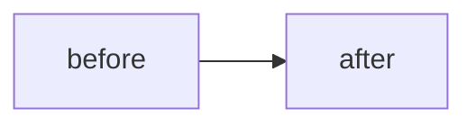

## Summary

<!-- One or two sentences: what this PR does. -->

## Motivation

<!-- Why this change is needed. Link issues if any. -->

## Changes

<!-- What moved. Include a mermaid sketch of the flow or layout when it helps. -->

## Test plan

<!-- Commands run and results. Label each number: measured, inferred, or guess. -->

## Risk / rollback

<!-- What could break, and how to undo this change. -->

## Checklist

- [ ] `uv run ruff check src tests scripts` and `uv run ruff format --check src tests scripts` pass.
- [ ] `uv run python -m unittest discover -s tests` passes. A bug fix comes with a test that failed before it.
- [ ] Tests use fakes: no real models, no downloads, no `data/`.
- [ ] A search change is a flag or config key, off by default, with the paired bootstrap result
      (see "Running an experiment" in CONTRIBUTING.md).
- [ ] A new model or dependency has a permissive license, written next to its alias in `docsearch.yaml`
      and in `THIRD-PARTY.md`.
- [ ] No files from `data/`, `corpus/`, `work/`, `logs/` or `results/runs/`, and no keys or personal paths.
- [ ] PR body keeps the six section headings in order and includes a mermaid fence.
- [ ] PR body has no agent footer stamps, no generation attribution, and no model ids.
