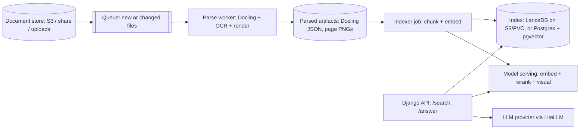
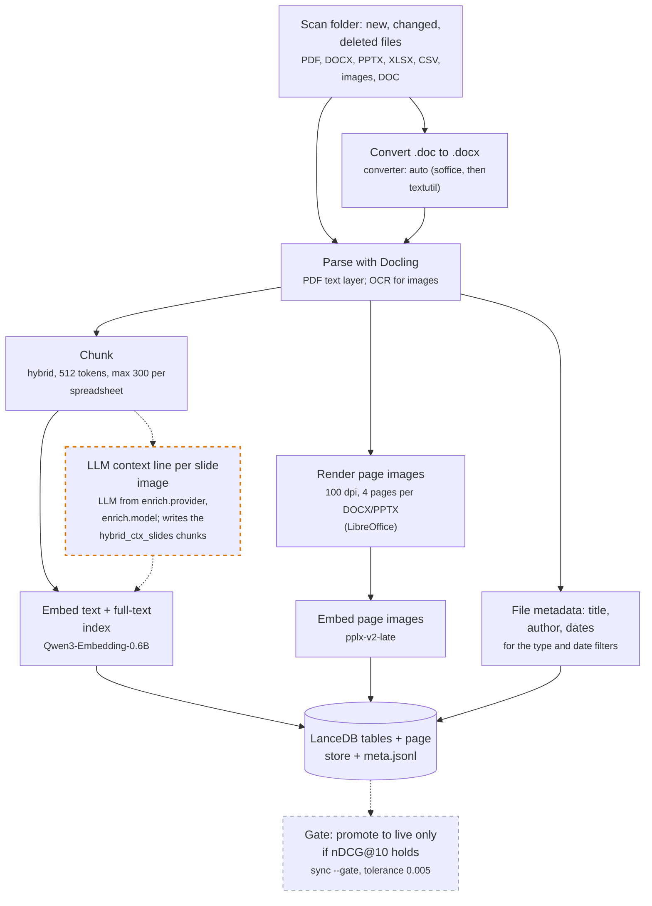

# Deployment considerations (OpenShift or a similar Kubernetes platform)

How to run docsearch as a service. Numbers marked *measured* come from the CPU phase (a CPU-only machine
with 8 vCPU, no GPU, 168-question subset); the rest are estimates to check under real load.

## 1. Shape of the system

**This is a proposed reference architecture, not what the code ships.** The diagram and the table below show
one way to run docsearch as a service. The code does not include the queue, the parse worker and indexer
containers, Postgres + pgvector, the access control or the `/answer` endpoint. Sections 7 and 8 show how you
could add them.

What the code provides today:

- `docsearch sync`: one process scans a folder, parses, chunks and embeds only the new and changed files, and
  removes deleted ones. `sync --gate` promotes the new index only if nDCG@10 holds.
- A LanceDB index on a local path (text chunks, page vectors and file metadata).
- The search library (`docsearch.search.search`) and the `docsearch search` command, with filters by format,
  date and folder.
- A local search page: a Django + Ninja API with read-only routes (`/api/search`, `/api/search/stream`,
  `/api/text`, `/api/file`, `/api/page`, `/api/config`) and no login or access control. Start it with
  `scripts/serve.sh`.
- The `docsearch answer` command (an LLM answer with citations, through LiteLLM or a CLI). It has no HTTP route.
- Models in-process, or the embedder and the text reranker on an OpenAI-compatible model server
  (`models.backend: api`).



| Stage | Kind | Container | Node |
| --- | --- | --- | --- |
| Parse worker | Deployment pulling from a queue (or a Job per batch) | Docling, RapidOCR, LibreOffice, pypdfium2 | CPU; memory-heavy (big spreadsheets needed >10 GB) |
| Indexer | Job / CronJob | docsearch + embedding client | GPU if embedding in-process; CPU if calling model serving |
| Search API | Deployment, HPA on CPU/latency | Django + docsearch library | CPU |
| Model serving | Deployment | TEI (text embeddings, rerankers) or vLLM; or in-process in the API | GPU preferred; CPU works with the small models |
| Eval | CI job | docsearch + fixed question set | CPU or GPU runner |

The parse worker and the indexer job run these stages, in this order:

<!-- diagram:ingest -->


Solid: on in docsearch.yaml. Dashed: off, or an option. Orange border: +enrich (an LLM at index time). Purple border: +agent (an LLM after search). Run `docsearch diagram` to draw your own config.
<!-- /diagram -->

**Model serving options.**
- *In-process* (what the repo does today): simplest, one image. Each API pod loads the embedder, the
  text reranker, the visual query encoder and the page-image reranker for slides (Qwen3-VL-Reranker-2B). Fine for
  low traffic; measure the memory of all four before you size the pods.
- *TEI* (Hugging Face Text Embeddings Inference): serves Qwen3-Embedding and sequence-classification
  rerankers such as gte-reranker-modernbert-base over HTTP, with batching. Check support for each model
  version before relying on it.
- *vLLM*: serves embedding, scoring, and multimodal models; the likely route for the visual retriever
  (pplx-embed-v2-late or EVIE) and for a local LLM.

**Model weights.** Pin every model to a revision (the repo already does this for remote-code models).
Either bake the weights into the image (immutable, larger images, simple rollbacks) or pull once onto a
read-only PVC / object store mounted at `HF_HOME` with `HF_HUB_OFFLINE=1` (smaller images, one shared copy).
Never download from the Hub at pod start in production.

## 2. Storage: LanceDB vs. Postgres + pgvector

| | LanceDB (on PVC or S3) | Postgres + pgvector |
| --- | --- | --- |
| Fit | Search-only service; files and vectors live together | App already runs on Postgres (as many Django apps do) |
| Dense vectors | Native, ANN (IVF-PQ/HNSW-style) indexes | `vector` / `halfvec`, HNSW or IVFFlat indexes |
| Keyword / BM25 | Native full-text index with BM25 (used here) | `tsvector` + `ts_rank` is not BM25; true BM25 needs an extension such as ParadeDB `pg_search` (check its AGPL license) |
| Multi-vector (MaxSim, page images) | Native multivector columns | No native MaxSim; store token vectors in a child table and score in SQL or app code, or use an extension (e.g. VectorChord; check license) |
| Transactions, joins, per-row ACLs | Limited; filter columns at query time | Full SQL: join to documents, permissions, row-level security |
| Ops | Files on a PVC (one writer) or S3 (many readers); backups are file copies | Existing backups, replicas, monitoring |
| Scale-out readers | Many API pods read the same S3 dataset | Read replicas |

**Recommendation.** Keep LanceDB on S3 for a standalone search service. Choose pgvector when the app is
already on Postgres and per-document permissions need to be joined in SQL; plan for the BM25 and
multi-vector gaps (an extension, or keep the page-image vectors in a side store as the repo does today).
On a PVC, LanceDB needs a single writer (the indexer) and readers that reopen the table after each index
version.

## 3. Re-indexing and staleness

`docsearch sync` is the re-index job; run it as a Kubernetes CronJob (or a long-lived `sync --watch`
Deployment with one replica) against the source folder or a mounted bucket.

- Change detection is by content hash per file (`work/manifest.sqlite`: path, size, mtime, sha256,
  parsed_at, doc_id, status). Only new or changed files are re-parsed, re-chunked and re-embedded (text chunks
  and page images); deletions remove chunks, page vectors and artifacts. Per-file status makes a killed pod
  resume where it stopped.
- Versions: `sync --gate` writes new LanceDB table versions, runs the eval gate (section 6), and only then
  moves the pointer `index/live.json` (table version + page-store snapshot) that `search`/`answer` read. A
  failed gate leaves the old version live (exit 1, so the CronJob shows as failed). Roll back by pointing
  `live.json` at an earlier table version.
- Run one sync at a time (CronJob `concurrencyPolicy: Forbid`); the SQLite manifest and LanceDB writes
  assume a single writer. With Postgres + pgvector, the manifest becomes a table and the pointer a row.
- Track staleness per document: `source_modified_at`, `indexed_at`, model revisions, chunker version. Expose
  the lag as a metric and alert when it passes an SLO (for example, 15 minutes).
- A model or chunker change is a full rebuild into a new version, never an in-place edit.
- Deletions must remove the chunks and page vectors in the same version, or a deleted file stays searchable.

## 4. Secrets, scaling, latency, caching

**Secrets.** LLM keys (`ANTHROPIC_API_KEY`, `OPENAI_API_KEY`, `XAI_API_KEY`) go in Kubernetes Secrets (or an
external secret manager synced into them) and are mounted only into the API pods that answer. Search and
indexing never need them. Never log keys; the repo's LLM layer only names the missing variable. The CLI
backends (`claude -p`, `codex exec`) are for a developer's machine, not for a cluster.

**Latency budget per /search** (CPU machine, *measured* where noted):

| Step | CPU machine | GPU (estimate) |
| --- | --- | --- |
| Query embedding (text + visual) | ~0.1-0.3 s (estimate) | <20 ms |
| BM25 + vector + page MaxSim (subset scale) | tens of ms (estimate) | tens of ms |
| Fusion | <5 ms | <5 ms |
| Rerank 30 pairs with gte | ~1.7 s/query (*measured*: 5,040 pairs in 294 s) | ~30-80 ms |
| Total | ~2 s | ~0.1-0.2 s |

The reranker dominates. Levers: fewer candidates (30 is the tested setting), shorter max length (384 now),
the `rerank_min_chars` skip, a GPU, or batching across concurrent requests in TEI. Zerank-2 (4B) costs
about 20x gte per pair (*measured*) with no measured quality gain; do not use it on CPU.

**Scaling.** API pods are stateless; scale on request latency. Model serving scales separately (GPU count).
Parse workers scale on queue depth; give them generous memory limits and a per-file timeout (the repo uses
600 s) so one bad file cannot block the queue.

**Caching.**
- Query embedding cache keyed by (model revision, query text).
- Rerank score cache keyed by (model revision, max length, query, passage hash); the repo already has this.
- Result cache keyed by (query, index version, user's permission set). Invalidate by index version.
- `/answer` responses: cache only if the permission set and index version are part of the key.

## 5. Observability

- Traces per request with spans for embed, retrieve, fuse, rerank, and LLM (OpenTelemetry).
- Metrics: latency per stage (p50/p95), candidates per query, rerank pairs scored, cache hit rates, empty
  results, LLM tokens and cost per answer, "not found" rate, index version and staleness lag.
- Logs: query id, index version, model revisions, top unit ids. Do not log document text or keys by default;
  treat queries as possibly sensitive.
- Feedback: record clicks and thumbs up/down on answers; sample them into the eval set.

## 6. Eval in CI as a quality gate

- Freeze a labeled question set. The development runs used the 168-question box subset (fast), the public set
  (734) and a reviewed hard-page set. The repo ships the code to build them (README, "Hard-page questions"), not
  the hard-page and custom sets. Add questions on your own files: the public sets do not test them.
- On every change to chunking, models, fusion, or prompts: run `docsearch eval` on a fixed small corpus and
  compare to the stored reference with `scripts/bootstrap_delta.py`. Fail the build if the overall nDCG@10
  CI is entirely below zero, or if any format with n >= 20 drops by more than a set margin.
- Run the same gate in the indexer before publishing a new index version.
- Unit tests and ruff run on every push, as in the repo today.

## 7. Security and per-document access control

- Store an ACL with every document (owner, groups, or tenant), copy it onto each chunk and page vector at
  index time, and filter on it inside the vector and keyword queries, not after. Filtering after the top-k
  leaks result counts and can return too few results.
- With pgvector, use row-level security tied to the request's user. With LanceDB, add a `where` filter on
  ACL columns, built only by the access layer.
- The LLM sees only chunks the user may read; citations link back through the same check.
- Parse untrusted files in a sandboxed worker: no network, read-only root filesystem, resource limits.
  LibreOffice and PDF parsers handle hostile input.
- Treat document text as untrusted input to the LLM (prompt injection). Do not give the answering model any
  tools or the ability to call out.

## 8. API layer (Django)

Keep the API layer thin. It returns only the fields that the caller may see:

- **Typed input and output**: declare a schema for each request and each response. A route returns only the
  fields of its response schema, never a whole internal object. The examples below use Django Ninja; any typed
  API framework works. Export the OpenAPI description so that the frontend can generate its types.
- **Thin routes, rules in a service module**: a route finds the caller, calls one service function and returns
  the result. The search and answer rules stay in the service module. One exception handler maps domain errors
  to HTTP responses.
- **One place for each concern**: one access module decides who a request is from and which documents it may
  read. One settings module reads the environment.
- **A leak test**: call each route as a caller with limited access. The test fails if a response holds a private
  field (an ACL entry, a source path, a document the caller may not read) or a field outside the response schema.
- Postgres via psycopg, `unittest` tests with Django's test client, ruff, and a CI job that runs them.

### Proposed layout

```
backend/
  config/            settings.py, env.py (index URI, model endpoints, LLM keys), urls.py
  access/            who the user is and which documents they may read (the only ACL code)
  search/
    services.py      search(), answer(), answer_stream(): call the docsearch library; no HTTP here
    api.py           Ninja routes: thin, typed, call services
    schema.py        optional Strawberry GraphQL over the same services
  tests/             the leak test; a check that routes never import docsearch directly
```

### Services (the only code that knows docsearch)

```python
# search/services.py
from dataclasses import dataclass
from docsearch.config import load_config
from docsearch.meta import Filter
from docsearch.search import search as _search

CFG = load_config()  # path from config/env.py

@dataclass
class Hit:
    doc_id: str
    page: int | None
    snippet: str
    score: float

@dataclass(frozen=True)
class Allowed(Filter):
    """Only the documents the caller may read (doc ids from the access module)."""
    docs: frozenset[str] = frozenset()

    @property
    def active(self) -> bool:
        return True  # always filter: an empty set allows no document, it does not turn the filter off

    def allows(self, m) -> bool:
        return m.doc_id in self.docs and super().allows(m)

def search(query: str, allowed: set[str], k: int = 10) -> list[Hit]:
    hits = _search(CFG, query, k=k, flt=Allowed(docs=frozenset(allowed)))  # the filter runs inside retrieval
    return [Hit(h["doc_id"], (h["pages"] or [None])[0], h["text"][:300], h.get("rerank_score", h["score"]))
            for h in hits]
```

`docsearch.search.search` turns the filter into a `doc_id` condition on each list: the keyword list, the text
vectors and the page vectors (LanceDB `where` with `prefilter=True`). Each list then keeps its own top k from
the allowed documents only, and the reranker sees only allowed candidates. An empty `allowed` set returns no
hits.

**Why not filter after the search.** A filter after the top k is wrong in three ways. The caller can get fewer
than k hits, or none, when documents they may not read hold the best matches. The number and the order of the
hits that remain depend on documents the caller may not read, so they leak facts about those documents. And the
reranker and any LLM step would read text the caller may not read. Section 7 has the same rule.

### REST routes (Ninja)

```python
# search/api.py
from django.http import StreamingHttpResponse
from ninja import NinjaAPI, Schema
import access
from . import services

api = NinjaAPI(title="Docsearch", version="1", docs_url=None)

class SearchIn(Schema):
    query: str
    k: int = 10

class HitOut(Schema):
    doc_id: str
    page: int | None
    snippet: str
    score: float

@api.post("/search", auth=access.a_reader, response=list[HitOut], operation_id="search", summary="Ranked pages and files")
def search(request, sent: SearchIn):
    return services.search(sent.query, access.documents(request), sent.k)

@api.post("/answer", auth=access.a_reader, operation_id="answer", summary="Answer with citations, streamed")
def answer(request, sent: SearchIn):
    stream = services.answer_stream(sent.query, access.documents(request))
    return StreamingHttpResponse(stream, content_type="text/event-stream")
```

**Streaming /answer.** `answer_stream` yields Server-Sent Events: first a `citations` event (the retrieved
pages), then `delta` events as LiteLLM streams tokens (`stream=True`), then `done`, or an `error` event.
Send `Cache-Control: no-store`, because the answer holds private data. Serve under ASGI (uvicorn or
gunicorn with uvicorn workers) so a long stream does not hold a sync worker; set the OpenShift route timeout
above the longest expected answer.

### Optional GraphQL (Strawberry) over the same services

```python
# search/schema.py
import strawberry
from . import services

@strawberry.type
class Hit:
    doc_id: str
    page: int | None
    snippet: str
    score: float

@strawberry.type
class Query:
    @strawberry.field
    def search(self, info, query: str, k: int = 10) -> list[Hit]:
        return [Hit(**h.__dict__) for h in services.search(query, info.context.allowed, k)]

schema = strawberry.Schema(query=Query)
```

Both front ends call `services.py`, so moving between REST and GraphQL changes only the outer layer. Keep
streaming on the REST/SSE route; GraphQL subscriptions would need Channels and add little here.

## 9. Rollout checklist

1. Build images per stage with pinned model revisions; weights on a read-only PVC or baked in.
2. Run the parse worker and indexer on a copy of the corpus; publish index version 1 after the eval gate.
3. Deploy the API with ACL filtering on and LLM keys mounted from Secrets.
4. Add dashboards for latency per stage, staleness, and "not found" rate.
5. Re-run the eval gate on every model, chunker, or prompt change and on every index publish.

## AWS managed alternatives

*Checked 2026-10-11 against aws.amazon.com and docs.aws.amazon.com. Prices are US list prices and change; confirm
on the linked page before quoting. Where a page renders prices only through its regional widget, this says
"see pricing page" rather than guessing.*

Our own results are the yardstick: the layers that moved the score were **structure-aware parsing/chunking**
(hybrid >> recursive), **the reranker** (+9.4 nDCG on text, but it hurt slides until M3), and **page-image
search** (+4.8 recall overall, big on slides; needed format-aware fusion). A managed service that hides those
layers removes the knobs that produced those gains, so each option below says which knobs you lose.

| Service | Replaces in docsearch | You give up | Pricing model and rough cost | Data residency |
|---|---|---|---|---|
| **Amazon Kendra** (GenAI Enterprise index) | Everything up to retrieval: parse, chunk, embed, BM25+vector, rerank (`Retrieve` API) | Parsing and chunking are opaque; no page-image search; no choice of reranker or fusion; no per-format rules like M3 | Always-on index hours. GenAI base index $0.32/h (~$230/mo) for up to 20k docs or 200 MB extracted text and ~0.1 QPS; +$0.25/h per extra storage unit, +$0.07/h per query unit; connector $30/index/mo. A 200k-doc example on the page is ~$1,981/mo. [1] | Regional; the index lives in the Region you create it in. Not offered in every Region, so check the Region list |
| **OpenSearch Service / Serverless** (hybrid + neural search) | The index and query layer (our LanceDB + RRF). Hybrid = BM25 + k-NN combined in a search pipeline; neural search embeds via a *remote* model connector | Least lock-in: you still choose the chunker, the embedder (via connector) and can call a reranker. Serverless supports only remote models, no custom plugins, and up to ~15 s delay before new vectors or pipelines show up. Multi-vector page search (our pplx-v2-late) has no native equivalent; you would store pooled page vectors. [2][3] | Serverless: indexing OCU-hours + search OCU-hours + GB-month storage. NextGen collections can scale to zero after 10 min idle (~10 s cold start). Classic has a minimum of 2 OCUs (0.5×2 indexing, 0.5×2 search). OCU rate: see pricing page. [4][5] | Regional; data stays in the chosen Region. VPC endpoints are available |
| **Bedrock Knowledge Bases**, Managed | Parse (managed multimodal "smart parsing" for PDF/PPTX/DOCX/scans), chunk, embed, store, hybrid retrieve, rerank, plus optional agentic multi-hop retrieval | Nearly every knob: parser, chunker, embedding model (you may swap in a Bedrock 1024-d float32 model), reranker (may swap in a Bedrock one). No visual page-embedding search for text queries in the managed mode. No per-format fusion or rerank-skip | $5.00 per GB of raw data per month for index storage; parsing, embeddings and the managed reranker $0; Retrieve (hybrid) $1.00 per 1,000 calls; agentic retrieve $4.00 per 1,000 + the underlying Retrieve calls. Our ~1–2 GB corpus would be roughly $5–10/mo storage + $1 per 1k queries. [6][7] | Regional. Check which Regions offer the managed mode; connectors (SharePoint, Confluence, Drive…) pull data into that Region |
| **Bedrock Knowledge Bases**, Customer-managed | Orchestration only. You pick the vector store (OpenSearch Serverless, Aurora pgvector, Neptune, S3 Vectors) and the parser (default text-only, a foundation model, or Bedrock Data Automation) | Less than the managed mode: you choose the store, chunking strategy and reranker. Still no visual multi-vector page retrieval. Nova Multimodal Embeddings give image similarity, but BDA is text-query-only. [8][9] | You pay for the parts: vector store, embedding tokens, parser (BDA is per page; a pricing example works out to $0.010/page for document Standard Output; foundation-model parsing is per token), rerank per query. See pricing page. [7] | Regional. Cross-region inference profiles for the models can process requests in another Region of the same geography; pin in-Region model IDs if that matters |
| **Bedrock Rerank** (`Rerank` API: Cohere Rerank 3.5, Amazon Rerank 1.0) | Just our gte reranker stage | Little control: no batch-size or max-length knobs, no per-format skip unless we keep that logic in our code (we would). Documents over 512 tokens are split, so each split is billed as another document | Per query, where one query covers up to 100 documents. Cohere Rerank 3.5 is $2.00 per 1,000 queries. Our top-30 rerank = 1 query, so ~$0.002 per search. Amazon Rerank 1.0: see pricing page. [7][10] | The Cohere 3.5 model card lists in-Region endpoints only (no geo or global inference) [11] |
| **Amazon Textract** | The Docling parse/OCR step for PDFs and images (not DOCX/XLSX/PPTX natively) | Docling's document structure (headings, reading order, table cells as a doc tree) that our hybrid chunker uses; you would rebuild chunks from Textract blocks. No native office formats; spreadsheets would still need our own parser | Per page. DetectDocumentText $0.0015/page for the first 1M pages, then $0.0006. AnalyzeDocument Tables $0.015/page (Layout is free with Tables), Forms $0.05/page (us-west-2 examples). 10k pages of OCR ≈ $15; with Tables ≈ $150. [12] | Regional, processed in the calling Region. AWS AI services have an organization-level opt-out policy for content use in service improvement (not re-checked in this pass; see the Textract FAQ) |
| **Amazon Q Business** (now steered toward Amazon Quick Suite) | The whole product: connectors, index, retrieval, answer generation, chat UI, permission-aware results | All of it: no retrieval metrics or access to the ranking, no custom parsing/rerank/visual search; it is an assistant, not a search component we can eval layer by layer | Per user plus index. Lite $3/user/mo, Pro $20/user/mo. Starter index $0.140/h per unit, Enterprise $0.264/h per unit (~$190/mo); one unit = 20k docs or 200 MB of extracted text. Images $0.003 each. Anonymous use: $200 per 30k units (2 units per chat call). The page now points new customers to Amazon Quick Suite. [13] | Regional, limited Region list; identity through IAM Identity Center or federation |
| **Amazon S3 Vectors** (GA Dec 2025) | Only vector storage and k-NN (part of LanceDB) | No BM25/keyword search, no hybrid fusion, no multi-vector (late interaction) scoring; top-k up to 100 per query; filtering by up to 50 metadata keys. We would keep BM25 elsewhere (or OpenSearch, which can use S3 Vectors as a cheaper vector tier) | Pay per use: $0.06/GB-month storage, $0.20/GB PUT, $2.50 per 1M queries, plus a small $/TB query-processing fee by index size. AWS's 1M-query example totals ~$11/mo. [14][15] | 14 Regions at GA (5 US/EU/APAC in preview plus Mumbai, Seoul, Singapore, Tokyo, Canada, Ireland, London, Paris, Stockholm) [16] |

**Takeaways**

- The closest drop-in that keeps our gains is **OpenSearch (hybrid) + Bedrock Rerank or our gte container**,
  with Docling parsing and our chunker upstream. The two things we would have to rebuild are page-image search
  (there is no managed multi-vector visual retriever) and the format-aware fusion and rerank-skip rules (M3),
  which live in our code either way.
- **Bedrock KB (managed)** is the cheapest and fastest to stand up, and is the best "what do we get for free"
  baseline, but it hides exactly the layers our experiments tuned.
- **Kendra and Q Business** are priced per hour or per user regardless of load. They suit an internal assistant
  more than a search component we want to measure and tune.
- **Textract** is a parsing alternative only for scans and PDFs; Docling still covers the Office formats.
- **S3 Vectors** is a storage-cost lever at large scale, not a retrieval-quality lever.

### Use a managed service as a baseline in the eval (recipe, not built)

The harness only needs a function `query -> ranked page units` (`doc_id#pN`), so a managed service can be scored
on the same questions with the same metrics and bootstrap CIs:

1. **Load the same corpus.** Upload `corpus/` to an S3 prefix and create a Bedrock Knowledge Base on it (managed
   mode, or customer-managed with BDA parsing). Keep the S3 key equal to our `doc_id` so hits map back. Wait
   for the sync to finish.
2. **Adapter.** Add `src/docsearch/baselines/bedrock_kb.py` with `search(query, k=10)` that calls
   `bedrock-agent-runtime.retrieve(knowledgeBaseId, retrievalQuery={"text": q},
   retrievalConfiguration={"vectorSearchConfiguration": {"numberOfResults": 30}})`. Map each result's
   `location.s3Location.uri` to `doc_id`, and its page metadata (`x-amz-bedrock-kb-document-page-number`,
   when the parser provides it) to `#pN`. If there is no page number, score at file level and say so.
3. **Plan entry.** Register it as an eval plan, e.g. `eval --full --baseline bedrock-kb --name
   aws_bedrock_kb`. It writes to `runs.csv` and the per-question file like any run. Cache responses in
   `work/cache/baselines/` so a re-run makes no calls.
4. **Compare.** Run `scripts/bootstrap_delta.py base aws_bedrock_kb --by format` (`base` is the reference run of
   CONTRIBUTING.md, "Running an experiment") on the
   public set, then on `--questions hard` (near-duplicate slides and dense tables are where we expect the
   managed stack to differ most).
5. **Cost and safety.** 734 + ~150 questions ≈ 900 Retrieve calls ≈ $0.90, plus ~$5–10 for a month of index
   storage. Delete the KB afterwards. It needs AWS credentials, which are never stored in the repo. The same
   adapter shape fits Kendra `Retrieve` and OpenSearch.

Sources (fetched 2026-10-11):
[1] https://aws.amazon.com/kendra/pricing/ ·
[2] https://docs.aws.amazon.com/opensearch-service/latest/developerguide/serverless-configure-neural-search.html ·
[3] https://docs.aws.amazon.com/opensearch-service/latest/developerguide/serverless-overview.html ·
[4] https://aws.amazon.com/opensearch-service/pricing/ ·
[5] https://aws.amazon.com/opensearch-service/features/serverless/ ·
[6] https://docs.aws.amazon.com/bedrock/latest/userguide/kb-build-managed.html ·
[7] https://aws.amazon.com/bedrock/pricing/ ·
[8] https://docs.aws.amazon.com/bedrock/latest/userguide/kb-advanced-parsing.html ·
[9] https://docs.aws.amazon.com/bedrock/latest/userguide/kb-multimodal-choose-approach.html ·
[10] https://docs.aws.amazon.com/bedrock/latest/userguide/rerank-pricing.html ·
[11] https://docs.aws.amazon.com/bedrock/latest/userguide/model-card-cohere-rerank-3-5.html ·
[12] https://aws.amazon.com/textract/pricing/ ·
[13] https://aws.amazon.com/q/business/pricing/ ·
[14] https://aws.amazon.com/s3/pricing/ ·
[15] https://aws.amazon.com/blogs/aws/amazon-s3-vectors-now-generally-available-with-increased-scale-and-performance/ ·
[16] https://aws.amazon.com/about-aws/whats-new/2025/12/amazon-s3-vectors-generally-available/
