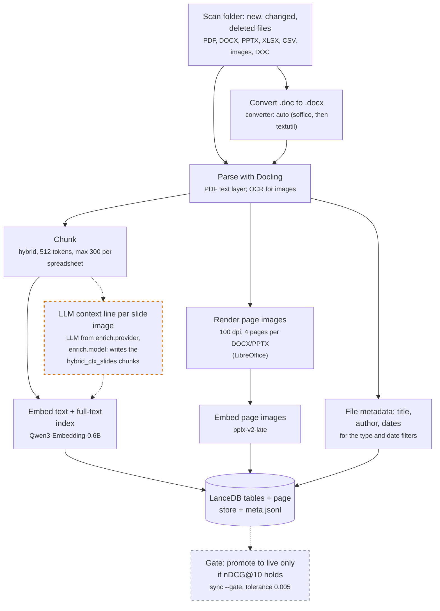
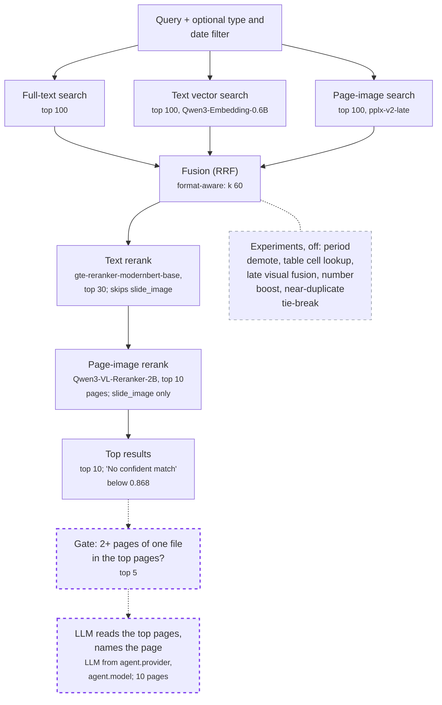
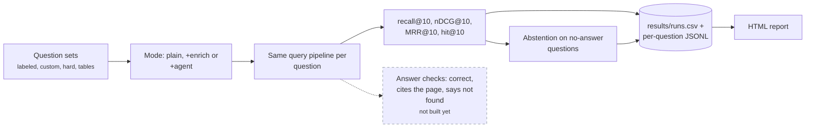
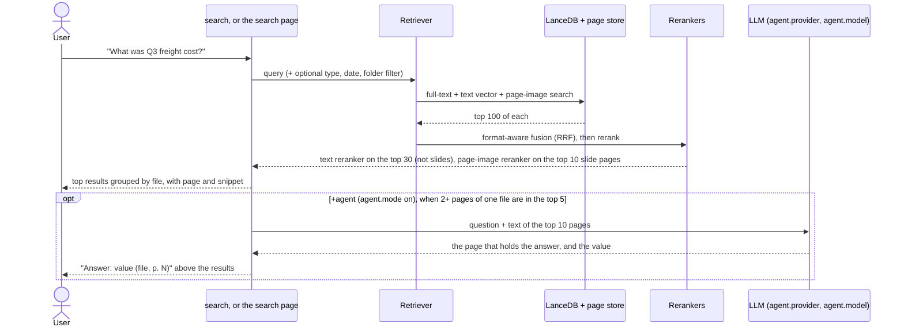

# docsearch

A test bench for search and RAG over a folder of mixed documents (PDF, Word, Excel, PowerPoint,
slide images, charts, scanned forms), with a combined, labeled dataset and a measured search default that
each challenger has to beat. The search phase is done: the default puts a gold page or file in the top 10 for
88% of the public questions (hit@10 0.879, recall@10 0.830, n=734) and 92% of the reviewed hard-page questions
(hit@10 and recall@10 0.919, n=87) on the full corpus [measured; REPORT.md, "Search phase conclusion"]. Next, in REPORT.md order: a held-out set on
your own files (Phase F), a public cross-file question set, then answer evaluation.

Everything except optional LLM calls runs locally: Docling for parsing, LanceDB for the index,
Qwen3-Embedding-0.6B for text vectors and the gte-reranker-modernbert-base text reranker
(`Alibaba-NLP/gte-reranker-modernbert-base`) through Sentence Transformers. The default also searches page
images: `perplexity-ai/pplx-embed-v2-late-0.6b` embeds the rendered pages, and Qwen3-VL-Reranker-2B reorders the
top 10 slide pages. The models of the default pipeline state a permissive license (Apache-2.0, MIT or
CDLA-Permissive-2.0, checked 2026-10-25). Some optional challenger models carry other terms, for example a use
policy. See [THIRD-PARTY.md](THIRD-PARTY.md) for each license and its source, and check it before corporate
use. Plain search and eval never call an LLM. The LLM steps are opt-in: +enrich (`enrich.llm`, at index time), +agent (`agent.mode`, after
search) and the `eval --abstain judge` check.

`results/` holds experiment outputs from the public benchmark sets used during development (see
[`results/README.md`](results/README.md)). Licensed MIT ([LICENSE](LICENSE)); see [CONTRIBUTING.md](CONTRIBUTING.md).

## Use as a template

docsearch is a local search engine for one folder of mixed documents, plus the test bench that chose its
settings. You can point it at your own folder and use only the search part. Search needs no LLM and no API key.

You need [uv](https://docs.astral.sh/uv/). LibreOffice renders Word and PowerPoint pages and converts old .doc
files (`brew install --cask libreoffice` on macOS, `apt install libreoffice` on Debian or Ubuntu). Bun
(https://bun.sh) builds the search page.

```bash
git clone https://github.com/matthewpergolski/docsearch && cd docsearch
uv sync                  # macOS. On Linux: uv sync --extra cpu (no GPU), or uv sync --extra cuda (NVIDIA GPU)
uv run docsearch sync --full --dir ~/Documents/reports   # parse, chunk, embed; the first run downloads the models
uv run docsearch search "travel policy for contractors"
scripts/serve.sh         # the search page at http://127.0.0.1:8765; on Linux: DOCSEARCH_TORCH=cuda scripts/serve.sh
```

- On Linux, keep the torch extra on each `uv run` (`uv run --extra cuda docsearch ...`, or `--extra cpu`), or set
  `UV_NO_SYNC=1`. Otherwise `uv run` re-syncs to the default torch. For the search page, set `DOCSEARCH_TORCH`
  to `cpu` or `cuda`.

- `--full` turns off the box subset (a fixed slice of the benchmark corpus). Run the same `sync` command again
  after files change: it reads only new and changed files and removes deleted ones.
- Keep: `src/`, `tests/`, `ui/`, `docsearch.yaml`, `pyproject.toml`, `uv.lock`, `scripts/serve.sh`,
  `scripts/verify.sh` with `scripts/verify_check.py` and `scripts/make_verify_fixture.py`, `LICENSE` and
  `THIRD-PARTY.md`.
- You can delete the research record of this repo: `decisions.tsv`, the `run_*.sh` scripts, `results/` (your
  own runs write new files there), `sources/images.json` (only `prepare` reads it) and the experiment scripts in
  `scripts/`. If you delete `REPORT.md` or `DEPLOYMENT.md`, also remove its name from `DOCS` in
  `src/docsearch/diagram.py`, or `tests/test_diagram.py` fails. If you delete `scripts/board.py` or
  `scripts/board_page.html`, delete `tests/test_board.py` too.
- To measure a change on your own files, write a labeled question set (see "Method" and `CONTRIBUTING.md`).

## Quick start (macOS on Apple Silicon or Linux)

```bash
# 1. Tools
curl -LsSf https://astral.sh/uv/install.sh | sh     # or: brew install uv
brew install --cask libreoffice                     # Word/PowerPoint page renders, .doc files; Debian/Ubuntu: apt install libreoffice
curl -fsSL https://bun.sh/install | bash            # Bun, for the search page only; or: brew install oven-sh/bun/bun
git clone https://github.com/matthewpergolski/docsearch && cd docsearch     # or copy the folder over

# 2. Python env from the lockfile (Python 3.12). Pick one:
uv sync                 # macOS (MPS) or Linux with the default PyPI torch (includes CUDA, large download)
uv sync --extra cpu     # Linux/Windows without a GPU: CPU-only torch wheels (smaller)
uv sync --extra cuda    # Linux + NVIDIA GPU: torch built for CUDA 13.0 (download.pytorch.org/whl/cu130)
# With an extra, keep it on later commands (`uv run --extra cuda docsearch ...`) or set UV_NO_SYNC=1,
# otherwise `uv run` re-syncs to the default torch.

# 3. Build everything with the adopted pipeline (resumable; re-run to continue after a stop)
uv run docsearch all --with-ingest --full   # first time: download + parse too, whole corpus
uv run docsearch all --full             # already parsed (e.g. copied work/parsed): chunk -> report, whole corpus
open results/report.html                            # macOS; xdg-open on Linux
```

`docsearch all` runs six stages: `chunk` (hybrid), `index`, `render`, `index --visual`, `eval`
(format-aware visual fusion + gte rerank, plus the same run without rerank), and `report`. With `--with-ingest`
it runs eight: `prepare` and `ingest` come first. Each stage skips
work that is already done (index rows, page renders, visual shards, the rerank cache), so an interrupted run
resumes. The recursive control is not part of `all`; run `chunk/index/eval --variant recursive` for it.

### Progress, warnings, logs

- On a terminal you get one line per stage with a progress bar (done/total, rate, ETA), the device at the
  start (`device: mps ...`), and a results table plus the `report.html` path at the end. When stdout is not a
  terminal (`nohup`, CI) the same information prints as plain lines.
- No warning is dropped. Every warning (`warnings.warn`, including Docling's off-page bbox notices) and all
  library logging go to `logs/run-<timestamp>.log`, and the run ends with a count such as
  `214 warnings logged → logs/run-20261009-195011.log`. Errors still show on screen.
  Add `--verbose` (`uv run docsearch --verbose all`) to see warnings live too.
- Hugging Face download bars show only while a model is not cached yet.
- Retention: the newest 20 `logs/run-*.log` files are kept (`logging.keep_runs` in `docsearch.yaml`); older
  ones are pruned at startup. Other logs in `logs/` (`phase1_*.log`, run-script logs) are never touched.

The steps can also be run one at a time:

| Command | What it does |
| --- | --- |
| `uv run docsearch prepare [--only vidore finslides ocb images]` | Download sources, build `corpus/`, `corpus/manifest.csv`, `data/questions.jsonl` |
| `uv run docsearch ingest [--source S] [--force]` | Docling-parse every file to `work/parsed/**.json`, log to `work/parsed/parse_log.csv` (resumable) |
| `uv run docsearch subset` | (Re)build the fixed-seed box subset in `data/subset.json` (a smaller slice of the benchmark corpus; `--full` on other commands ignores it) |
| `uv run docsearch chunk [--variant hybrid\|recursive]` | Write `work/chunks/<variant>.jsonl` + stats |
| `uv run docsearch index [--variant ...] [--rebuild]` | Embed chunks into LanceDB and build the full-text index (resumable) |
| `uv run docsearch render [--full]` | Render pages, slides and images for visual retrieval (LibreOffice for Word and PowerPoint) |
| `uv run docsearch eval [--runs NAME ...] [--sources S ...] [--limit N]` | Run retrieval evals, append to `results/runs.csv`, rebuild the report |
| `uv run docsearch eval ... --mode plain\|enrich\|agent` | Eval mode (default `plain`: `enrich.llm` and `agent.mode` off for the run). `agent` runs the +agent step (`agent.mode` on). `enrich` is not built as an eval mode yet and stops with a message |
| `uv run docsearch sync [--dir PATH] [--dry-run] [--gate] [--watch]` | Incremental update for new/changed/deleted files (see "Incremental sync") |
| `uv run docsearch report` | Rebuild `results/report.html` |
| `uv run docsearch diagram [ingest\|query\|eval] [--write\|--check\|--html PATH]` | Draw the pipeline from the code and `docsearch.yaml` (Mermaid; see "Architecture") |
| `uv run docsearch search "query" [--no-rerank] [-k 10] [--scores] [--json] [--agent]` | Interactive search; results grouped by file (see "Search results") |
| `uv run docsearch search "query" [--format FMT ...] [--after YYYY-MM-DD] [--before YYYY-MM-DD] [--folder PREFIX]` | Search only the files that match (see "Filters and file details") |
| `uv run docsearch meta` | Read title, author and dates from inside every file in `corpus/manifest.csv` into `work/meta.jsonl` (no models; `sync` keeps it current) |
| `uv run docsearch answer "question" [--backend api\|cli] [--provider ...]` | Retrieve, then answer with file/page citations (needs an LLM backend) |
| `uv run docsearch draft-questions [--n-multi 20 --n-none 10]` | LLM-draft multi-document and no-answer questions (unreviewed) |
| `uv run docsearch questions draft [--n N] [--hard] [--hard-from RUN]` | Draft custom or hard-page questions with an LLM (resumable); see "Hard-page questions" |
| `uv run docsearch questions lint \| review \| apply-suggestions \| paraphrase` | Flag stitched questions, review them in the terminal, apply suggested decisions, or paraphrase kept questions (see the custom-question section) |
| `uv run --extra ui docsearch serve [--host H] [--port P]` | The local search page and its API (default `127.0.0.1:8765`; see "Search page"; `scripts/serve.sh` builds the page first) |
| `uv run docsearch llm-status` | Which LLM backends are usable here (never prints keys) |

Tests and lint:

```bash
uv run python -m unittest discover -s tests
uv run ruff check src tests scripts && uv run ruff format --check src tests scripts
```

## Search results

`search` groups the ranked hits by file, in the order of each file's best page. A slide deck counts as one file.
Under each file come its matching pages: the slide or table title and a snippet around the query's words. The
date (from inside the file) or the quarter in the file name shows when it is known.

```text
$ uv run docsearch search "How many days of paid leave does a new baker get each year?"
 1. Brindlewick Bakery staff handbook | 2024-03-04
    verify/handbook.docx
    …at 04:30 and ends at 12:30. Bakers sign in at the back door. Paid leave. Every new baker receives 18 days of paid leave each year, plus public…
 2. Brindlewick Bakery budget 2026 | 2026-01-05
    verify/budget.xlsx
    p. 2   Table 2 · Item | Cost (EUR) | Quarter / Farmers market stall fee | 640 | Q2 / Printed menu cards | 310 | Q1 / Local radio advert | 1900 | Q4
    p. 1   Table 1 · Item | Cost (EUR) | Quarter / Deck oven replacement | 12500 | Q1 / Dough sheeter | 3800 | Q2 / Walk-in cooler repair | 2150 | Q3
```

- The ranked list is the one eval scores. Grouping changes only what is shown.
- `--scores` adds each page's score and its scorer: `rerank` (text reranker), `page` (page-image reranker on
  slides) or `fused` (not reranked). The scales differ, so compare scores of one scorer only.
- `No confident match; the nearest results follow.` shows when the top hit has a text-reranker score below
  `search.abstain_threshold` (0.868, measured in M6). A top hit from another scorer gets no such line, because no
  threshold was measured for it.
- `--json` prints the same groups for scripts (`query`, `confident`, `answer`, `groups`, `chunk_ids`), with
  status lines on stderr.
- `--agent` (or `agent.mode: "on"`) runs the +agent step (an LLM through `agent.backend`): when the
  top pages hold two or more pages of one file, the LLM names the page that holds the answer and the value. Search
  prints `Answer: <value> (<file>, p. N)` first and the plain results below. No call (the gate), no page or a
  failed call prints nothing extra.

## Search page

A local web page for the same search: `docsearch serve` runs a small API (Django + Django Ninja) and serves the
page (Vite + React). The page shows the groups that `search --json` gives, with no ranking change.

```sh
scripts/serve.sh                          # build the page, then serve it at http://127.0.0.1:8765 (needs Bun)
scripts/serve.sh --port 9000              # arguments go to `docsearch serve`
```

The script does these steps:

```sh
(cd ui && bun install --frozen-lockfile && bun run build)   # the page, into ui/dist
uv run --extra ui docsearch serve                           # adds Django and Django Ninja, keeps other extras
```

- Search as you type: the full search runs after a 0.35 s pause, or at once on Enter. A new search stops this
  tab's search still running (the server answers 409; the page ignores it), so the newest text is searched first.
  Searches from other tabs wait their turn. Earlier answers are kept, so going back to a text is instant. Escape,
  the × or the docsearch name clears the field; `/` jumps to it.
- Speed on an Apple-silicon laptop [measured, new queries]: a text search 0.85 to 0.96 s; a slide search 6.5 to 7 s when the
  question is refined (the slides' vision features stay in memory for the 64 latest pages), up to about 13 s for
  slides not seen before. The server keeps its index reader loaded until a sync or index run changes the index.
- Progress: each step shows as the server runs it. Waiting (for another search, or for the models at start),
  looking through the files, ranking the best passages (with the candidates' files per type, each type drawn as
  a small sheet that is being read), and reading the slides (a strip of the slides, each lit when read). While
  slides are read, the results that are not slides show at once in their final order (only while no ranking step
  after the page rerank is on: `search.early_safe`).
- On a wide screen (1280 px and up), a click on a result's picture or a page number shows that page large on the
  right; the × or Escape closes it. A page with no picture (a spreadsheet, a page `render` did not draw) shows its
  text from the index, tables as tables. On a narrower screen the click opens the file.
- The page asks for the 30 reranked passages (the CLI shows 10), so more files show.
- A file named by an opaque id (a uuid) shows the first line of its first passage as its name; snippets show no
  Markdown bold marks (both in `search` too).
- Filters need the file details from `docsearch meta`; without them the Filters panel says so.
- Results group by file, with page numbers, the slide or table title and a snippet. The query's words are marked.
  A spreadsheet snippet shows as a small table.
- Each result shows the picture of its best page, from the page pictures `render` made. Hover over it to see it
  larger. A file with no picture (Excel, CSV, or a page `render` did not draw) shows a blank ruled sheet.
- Click a result's name to open the file in a new tab, at its best page; click a page number to open that page.
  A PDF, image, slide or CSV opens in the browser. A Word or PowerPoint file opens as the PDF copy that
  `render` made, if there is one; otherwise, and for Excel, the browser downloads the file.
- Filters: the Filters button in the search field opens file types, dates and folder, as `search --format/--after/--before/--folder`.
- "No confident match" shows above the results, as in `search`.
- The LLM toggle shows only when `agent.mode` is `on`. Plain search is the default.
- Themes: light and dark. The default follows the system; the button at the top switches to the other theme.
- The empty page offers the searches in `web.examples` (`docsearch.yaml`).
- The models load in the background when the server starts, and one example search runs, so the first real
  search does not pay one-time GPU costs (ready after about 24 s on an Apple-silicon laptop [measured: 1 run]). They stay
  loaded; the page says so until they are ready. One search runs at a time. The
  server listens on 127.0.0.1 only and has no login, so do not expose it to a network.
- API: `GET /api/config`, `GET /api/search?q=...&k=10&formats=pdf&after=YYYY-MM-DD&before=...&folder=...` (header `X-Docsearch-Tab`: a newer search from the same tab stops it, 409), `GET /api/search/stream` (the same, as lines of JSON: waiting, stages, early results, slide progress, done), `GET /api/text?file=<file>&page=N` (a page's text, for a preview) and
  `GET /api/file?file=<file>&page=N` (only files in `corpus/manifest.csv`), and `GET /api/page?file=<file>&page=N`
  (the page's picture; only pages in `work/pages/pages.jsonl`). `/api/search` returns
  `{"results": <search --json>, "notes": [...], "terms": [...]}`; bad input gives 400 with the reason in `detail`.
- Work on the page: `cd ui && bun run dev` (proxies `/api` to `docsearch serve` on port 8765), `bun run
  storybook` (each component in light and dark), `bun run lint` (Biome), `bun test src`, `bun run e2e`
  (Playwright, light and dark at desktop and phone size, API mocked; needs `bunx playwright install chromium`).

## Filters and file details

`search` can narrow the results to some files. No LLM is involved, and with no filter the results are the same as
before filters existed.

```sh
uv run docsearch meta                                          # once, for a corpus built by `all` or `ingest`
uv run docsearch search "staff leave" --format docx pdf
uv run docsearch search "staff leave" --after 2024-01-01 --before 2024-12-31
uv run docsearch search "staff leave" --folder office/ocb
```

- The details come from inside each file: Word, PowerPoint and Excel core properties (title, author, created,
  modified) and the PDF Info dictionary. CSV and image files have only their name and folder. They are stored in
  `work/meta.jsonl` (next to `paths.index_dir`), one row per file. `sync` writes the row of each new or changed
  file and removes the row of a deleted file.
- A file's date is its last change, else its creation, as the file itself states. The file system date is never
  used: a copied folder gives every file the copy time. A file with no date of its own is left out when `--after`
  or `--before` is given. Both dates are inclusive.
- `--folder` is a folder relative to `paths.corpus_dir`; its subfolders count too.
- The filter is applied before each candidate list is cut to its size, so a filtered search still returns up to
  `-k` hits when enough matching files contain the words, even if none of them is near the top without the filter.
- `answer` does not take filters.

## Incremental sync (new, changed and deleted files)

`docsearch sync` keeps the index in step with a folder without rebuilding everything.

```bash
uv run docsearch sync --dry-run                 # counts only: new, changed, deleted, unchanged
uv run docsearch sync                           # default folder: paths.corpus_dir
uv run docsearch sync --dir ~/Documents/reports # any folder (files outside the corpus get doc_id <folder>/<path>)
uv run docsearch sync --full                    # whole corpus (no box subset), same as `all --full`
uv run docsearch sync --gate                    # promote to live only if nDCG@10 holds (see below)
uv run docsearch sync --watch --interval 900    # loop in the foreground; Ctrl-C stops it
```

- State is `work/manifest.sqlite` (`paths.sync_manifest`): one row per source file with path, size, mtime,
  sha256, parsed_at, doc_id and status. Files are compared by sha256, so a touched file is unchanged and an
  edited file with the same name is changed.
- New or changed files: Docling re-parse of just those files, re-chunk, then only their text chunks and page
  images are re-embedded. Old rows for a changed file are removed first, so no stale text stays searchable.
- Deleted files: their chunks leave LanceDB, their page vectors leave the page store, and their parsed JSON,
  page renders, parse-log row and `corpus/manifest.csv` row are removed.
- Idempotent and resumable: each file moves `pending -> parsed -> chunked -> ok` (or `failed`), and the status
  is saved after each step. Re-run after a crash and it continues where it stopped. A file that failed to
  parse is not retried until its content changes.
- First run on an existing corpus: files already in `work/parsed/parse_log.csv` with matching content are
  adopted (recorded, not re-parsed). `ingest` now also stores sha256 in the parse log and re-parses a file whose
  content changed; older log rows are trusted once and backfilled.
- Files sync does not parse are named: other file types as a count per extension (`ignored 17: .py 3, .txt 2`),
  0-byte files (`empty (0 bytes), skipped: N`), and files that failed to parse, with the error.

### File types

PDF, Word (.docx and .doc), PowerPoint (.pptx), Excel (.xlsx, .xlsm), CSV and images (.png, .jpg, .tif). An old
Word file (.doc) is first converted to .docx with an external program, then parsed as a .docx; it keeps its own
name and is listed under the `docx` format (`--format docx`). Install LibreOffice for this (`brew install --cask
libreoffice` on macOS, `apt install libreoffice-writer` on Debian or Ubuntu). On macOS without LibreOffice, the
built-in `textutil` is used: it keeps the text but flattens tables and drops pictures. With no converter, sync
skips each .doc file and names it (`2 .doc files skipped: no converter ...`); the next sync after the install picks
them up. `ingest.doc_converter` (auto, soffice, textutil, off) picks the program. A .doc file gets no title,
author or dates from inside the file (both converters change the dates), so a date filter leaves it out unless
`--undated` is given.

### Live version and the quality gate

`index/live.json` (under `paths.index_dir`) says which index version `search` and `answer` serve: the LanceDB
table version plus a hard-linked snapshot of the page-vector store. There is no pointer until the first
`sync --gate`; until then search reads the latest index.

- `sync --gate` evaluates the updated index on the labeled questions (format-aware fusion + rerank). It becomes
  live only if nDCG@10 >= live nDCG@10 - `sync.gate_tolerance` (default 0.005). Otherwise the previous version
  stays live, the command prints `gate: HELD ...` and exits 1. The next `sync --gate` re-checks it.
- `sync` without `--gate`, and `index`/`all`, move an existing pointer to the latest index (ungated).
- The gate only measures the benchmark questions. Files from your own folder have no labeled questions, so
  the gate catches a broken index or pipeline, not a bad new document.

### Scheduling (optional, off by default; nothing is installed for you)

cron (Linux or macOS), every 15 minutes:

```cron
*/15 * * * * cd /path/to/docsearch && $HOME/.local/bin/uv run docsearch sync --full --gate >> logs/cron-sync.log 2>&1
```

launchd (macOS): save as `~/Library/LaunchAgents/com.example.docsearch-sync.plist`, then
`launchctl load ~/Library/LaunchAgents/com.example.docsearch-sync.plist` (`unload` to stop).

```xml
<?xml version="1.0" encoding="UTF-8"?>
<!DOCTYPE plist PUBLIC "-//Apple//DTD PLIST 1.0//EN" "http://www.apple.com/DTDs/PropertyList-1.0.dtd">
<plist version="1.0"><dict>
  <key>Label</key><string>com.example.docsearch-sync</string>
  <key>WorkingDirectory</key><string>/path/to/docsearch</string>
  <key>ProgramArguments</key><array>
    <string>/opt/homebrew/bin/uv</string><string>run</string><string>docsearch</string>
    <string>sync</string><string>--full</string><string>--gate</string>
  </array>
  <key>StartInterval</key><integer>900</integer>
  <key>StandardOutPath</key><string>/path/to/docsearch/logs/launchd-sync.log</string>
  <key>StandardErrorPath</key><string>/path/to/docsearch/logs/launchd-sync.log</string>
</dict></plist>
```

Check the `uv` path with `which uv`. Don't schedule a sync while a full `all` run is going: both write the
same index. For a foreground loop, `sync --watch` does the same job.

## Hardware and devices

- docsearch uses a GPU (CUDA or Apple MPS) when available, otherwise CPU. One helper (`config.pick_device`)
  chooses the device for the embedders, rerankers, the vision reranker and Docling's layout/OCR models, and
  logs the choice. Override with `DOCSEARCH_DEVICE=cuda|mps|cpu|auto` (wins) or `models.device` in the config. `models.embed_dtype` / `models.rerank_dtype: auto`
  use float16 on MPS/CUDA (float32 / bfloat16 on CPU). If you ever see NaN scores on MPS, set
  `DOCSEARCH_MODELS_EMBED_DTYPE=float32 DOCSEARCH_MODELS_RERANK_DTYPE=float32`.
- No path in the code is machine-specific. All directories come from `docsearch.yaml` (`paths:`),
  relative to the config file. To keep data on another disk:
  `DOCSEARCH_PATHS_CORPUS_DIR=/Volumes/Data/corpus uv run docsearch ingest`.
- Any config key can be overridden by env: `DOCSEARCH_<SECTION>_<KEY>`, e.g.
  `DOCSEARCH_SEARCH_RERANK_CANDIDATES=50`, `DOCSEARCH_SAMPLING_VIDORE_CORPORA=vidore_v3_hr,vidore_v3_energy`.
- The rerank budget is the same on every device: `docsearch.yaml` sets 30 candidates
  (`search.rerank_candidates`) at 384 tokens (`models.rerank_max_length`), the setting all runs used. The code
  defaults without a config file are larger (50 and 512).
- Disk: about 3 GB for data and models in the phase-1 configuration. Models download to the
  Hugging Face cache (`~/.cache/huggingface`) on first use.

## Models through an API

An organisation can run the text embedder and the text reranker on its own model server and point docsearch at
it. docsearch then loads neither model. Docling (parsing) still runs locally; it is small and runs on a CPU. The
default stays `models.backend: local`, so nothing changes for a local install.

```yaml
models:
  embedder: Qwen/Qwen3-Embedding-0.6B                    # the model the server runs (the index records it)
  reranker: Alibaba-NLP/gte-reranker-modernbert-base
  backend: api
  embed_api_url: https://models.example.internal/v1      # POST <url>/embeddings
  rerank_api_url: https://models.example.internal/v1     # POST <url>/rerank
  embed_api_model: ""        # the name the server uses, if not the one above
  rerank_api_model: ""
```

```bash
export DOCSEARCH_EMBED_API_KEY=...    # bearer keys; leave unset for a server with no key
export DOCSEARCH_RERANK_API_KEY=...
uv run docsearch sync --dir ~/Documents/team-folder
uv run docsearch search "travel policy for contractors"
```

- Keys come only from env vars. The config names the variables (`models.embed_api_key_env`,
  `models.rerank_api_key_env`), never the keys. The keys are never logged.
- The embedder endpoint is the OpenAI shape: `{"model", "input": [...]}` returns `{"data": [{"index",
  "embedding"}]}` (vLLM, TEI, Infinity, Ollama, a LiteLLM proxy). The reranker endpoint is the common `/rerank`
  shape: `{"model", "query", "documents": [...], "top_n"}` returns `{"results": [{"index", "relevance_score"}]}`
  (Cohere, Jina, vLLM, Infinity). TEI wants the passages in `texts` and returns a bare list with `score`: set
  `models.rerank_api_field: texts`. The client reads both answer shapes and orders the results by `index`.
- The client adds the model's query lead-in (for Qwen3-Embedding, its "Instruct: ... Query:" line) and
  normalises the vectors, as the local path does. So the server must embed the text as it gets it. To know the
  lead-in, docsearch reads the model's `config_sentence_transformers.json` from Hugging Face. When it cannot (a
  model that is not on Hugging Face, or no network and no cache), it embeds with no lead-in and logs a warning.
  Set `models.embed_api_query_prefix` to give the query lead-in by hand (`""` = none; documents get none).
  Chunking also reads the embedder's tokenizer; when it cannot load it, chunking stops with a message. Set
  `models.embedder` to the model's Hugging Face id and the server's name in `models.embed_api_model`. Both are
  small files with no weights.
- **Text-only.** The page-picture model and the vision reranker have no common server API (many vectors per
  page), so `api` ignores `visual.default`, and `--visual` / `--embedder` stop with a message. Search is then
  keywords + text embedding + text reranker. On this repo's test sets that pipeline is close to the default for
  Word, PDF, PowerPoint and Excel and weaker for slide images (see `REPORT.md`, Stage 14).
- **Guard.** The index records the embedder that built it (`<table>.stats.json`) and its vector width. A search
  or an index update with another model or another width stops with an error that names both. To change models,
  rebuild: `docsearch index --rebuild`.
- Each request has a timeout (`models.api_timeout_s`, 60 s). A 5xx, a 429, a timeout or a lost connection is
  tried again up to `models.api_retries` times (waits of 1, 2, 4 s). Each failed try is a warning in
  `logs/run-*.log`; each batch of texts is an info line there. `models.api_batch_size` (32) caps the texts per
  request (TEI's default limit is 32).
- Reranker scores from the server go to their own cache file (`work/cache/rerank_api_<model>_<url hash>.jsonl`),
  and cached query vectors are keyed by the server URL too. An api run never reads local scores or vectors, and
  a local run never reads api ones.
- Two server settings decide whether results equal a local install: the reranker's input length (local cuts each
  query + passage at `models.rerank_max_length`, 384 tokens) and the score scale. A different scale (for example
  raw logits against a sigmoid) keeps the order of results, but changes `search.abstain_threshold`.

Servers tried so far: only `scripts/model_server.py`, a stdlib test server that serves the local models with the
local settings (`uv run python scripts/model_server.py --port 8088`; `--fake` gives deterministic stand-ins with
no model). Against it, query vectors matched the local ones (cosine at least 0.9999998 on 200 questions), and
the text-only evals gave the same top 10 as the local backend on all 87 hard and all 734 public questions
[measured, decisions.tsv rows G0 and G1]. That proves the request shapes and the client, not one vendor's
pooling or truncation. A real server (TEI, vLLM, Infinity) is not tried yet.

## LLM backends (answering and question drafting only)

Selected by `llm.backend` and `llm.provider` in `docsearch.yaml`, by env
(`DOCSEARCH_LLM_BACKEND=cli DOCSEARCH_LLM_PROVIDER=openai`), or per command
(`--backend cli --provider claude --model opus`). The default answer and draft model of each provider is set in
`llm.api_models` and `llm.cli_models` (the tables below show the shipped values).

**API keys (`backend: api`, via LiteLLM)**

| provider | env var | default answer / draft model |
| --- | --- | --- |
| `claude` | `ANTHROPIC_API_KEY` | `anthropic/claude-sonnet-5-5` / `anthropic/claude-haiku-5-5` |
| `openai` | `OPENAI_API_KEY` | `openai/gpt-5.6` / `openai/gpt-5.4-mini` |
| `grok` | `XAI_API_KEY` | `xai/grok-4.7` |
| `ollama` | none (local server) | `ollama/qwen3:8b`, server at `llm.ollama_api_base` |

```bash
export ANTHROPIC_API_KEY=...        # put it in your shell profile or a password manager, not in the repo
uv run docsearch answer "What was IBM's gross margin in Q4 2017?"
```

**Subscriptions (`backend: cli`, by subprocess)**, for when you're signed in to the vendor CLI
instead of holding an API key:

| provider | binary | how it's called | sign in |
| --- | --- | --- | --- |
| `claude` | `claude` (Anthropic CLI) | `claude -p --output-format text [--model sonnet]`, prompt on stdin | run `claude` once and log in |
| `openai` | `codex` (Codex CLI) | `codex exec --skip-git-repo-check --sandbox read-only --ephemeral -o <file> [-m MODEL] -`, prompt on stdin, final message read from `<file>` | `codex login` |
| `grok` | `grok` (xAI grok CLI) | `grok --prompt-file <file> --output-format plain --disable-web-search --no-subagents [-m MODEL]` | `grok login` |

```bash
uv run docsearch answer "..." --backend cli --provider claude
uv run docsearch answer "..." --backend cli --provider openai
```

The CLIs run with a timeout (`llm.timeout_s`, default 180 s). If a key, binary, server, or sign-in
is missing, `answer` and `draft-questions` exit with code 2 and a message saying exactly what to
set; nothing else is affected. Key values are never printed or logged.

## Data sources and licenses

| Source | Format in corpus | Gold level | License | Notes |
| --- | --- | --- | --- | --- |
| [ViDoRe V3](https://huggingface.co/vidore) (`vidore_v3_hr`) | native PDF | page | CC-BY-4.0 (per-document) | Human-written queries; English only; page qrels with graded relevance (1–2) |
| [Office Comprehension Bench](https://huggingface.co/datasets/microsoft/OfficeComprehensionBenchmark) | docx, pptx, xlsx/xlsm, csv | file | CDLA-Permissive-2.0 for OCB-hosted files and questions; URL-referenced files stay under their publishers' terms | Questions filtered for pooled retrieval (below). URL-referenced files are fetched from the original publishers for local evaluation only and are not redistributed |
| [REAL-MM-RAG FinSlides](https://huggingface.co/datasets/ibm-research/REAL-MM-RAG_FinSlides) | slide images (PNG) | page (= slide) | CDLA-Permissive-2.0 | IBM earnings-deck slides; hard distractors across quarters |
| Public-domain images (`sources/images.json`) | charts and scanned forms (PNG) | page (= image) | Public domain / CC0 (Wikimedia Commons; U.S. Government works from IRS and USCIS) | Questions written by hand while viewing each image |

Corpus files are not committed; `uv run docsearch prepare` re-downloads them.

### Sampling (phase-1 CPU run; all in `docsearch.yaml: sampling`)

- ViDoRe: one corpus (`vidore_v3_hr`, 14 PDFs, 1,110 pages), all pages indexed; 150 of its 318
  English queries sampled with seed 13. The other 6 public ViDoRe V3 corpora are one config change away.
- FinSlides: 12 of 65 decks sampled with seed 13; every slide of those decks is indexed and every
  query whose slide is in them is kept.
- OCB: Domain track dropped (its files need PDF→Office conversion and its prompts are multi-page
  tasks). URL-referenced files that required conversion, 403/404'd, or failed TLS are skipped and
  logged in `data/prepare_log.json`. CSV/XLSX over 3 MB are skipped (row-heavy files explode into
  thousands of chunks); docx/pptx up to 40 MB are kept.
- OCB question filter (pooled retrieval needs questions that could identify their file): single-file
  questions only; drop formatting/structure features (font, colour, highlight, header/footer,
  comments, metadata, hyperlinks, slide notes, formulas, …); drop questions that reference "this
  document/deck/workbook", "slide N", "page N", "item N", "footnote N", or cell addresses; drop
  questions under 6 words. The trailing "Do not use web search…" instruction is stripped.

### Box subset (`docsearch.yaml: subset`; `--full` turns it off)

The box subset is sized for a CPU-only machine (8 vCPU, no GPU). That machine cannot embed the full corpus
(~14.6k hybrid chunks) in reasonable time, so the CPU run
indexes and evaluates a fixed-seed slice built by `uv run docsearch subset` → `data/subset.json`:

- Questions per source (seed 13): ViDoRe 30, FinSlides 60, OCB 50, images 28 (all).
- Kept units = the pages/files referenced by those questions plus 2x as many fixed-seed distractor
  units from the same source (ViDoRe: 100 gold + 200 distractor pages across all 14 PDFs;
  FinSlides: 55 + 110 slides; OCB: 38 + 76 files; images: all 15).
- docx/pptx/xlsx/csv are capped at 8 chunks per document inside the subset; spreadsheets are capped at
  300 chunks in the full corpus. Docs whose Docling JSON exceeds 100 MB are excluded (4 large
  spreadsheets) and their questions are dropped from eval and counted.
- `corpus/manifest.csv` still lists the full corpus; the subset is a filter recorded in `data/subset.json`.

On a GPU or Apple-silicon machine, run the full corpus with `uv run docsearch all --full` (or `chunk --full`, `index`, `eval --full`).

### Chunking details

- Spreadsheets (xlsx/csv) use a row-group chunker: each chunk repeats `File:`, the table number, and
  the header row (HybridChunker is quadratic on large tables).
- Images and slide images: the OCR text (including text Docling nests under picture items) becomes
  the chunk text, so every parsed image produces a chunk.

## Method

1. One pooled folder; every question searches the whole corpus, not just its own source.
2. Gold is pages (ViDoRe, FinSlides, images) or files (OCB). Retrieved chunks are mapped to those
   units and de-duplicated in rank order, so every chunking variant is scored on the same targets.
3. Metrics: recall@10, nDCG@10 (graded where the source has grades), MRR@10, hit@10; overall,
   per format, per source, plus a macro average over formats.
4. Change one thing at a time against the locked baseline; keep a change only if it beats the
   baseline by more than noise. Every run is a row in `results/runs.csv` with its config.

### Phase-1 baseline pipeline (not the default)

This section records the phase-1 baseline, the first reference of the experiments. The current default is
different: it adds page-image search and format-aware fusion, and it reranks with gte-reranker-modernbert-base on
the top 30 (not Qwen3-Reranker-0.6B) and with the page-image reranker on slides. See "Architecture" and
REPORT.md, "Search phase conclusion".

- **Parse:** Docling. PDFs use the embedded text layer (no OCR) with table structure;
  images go through full-page OCR (RapidOCR); docx/pptx/xlsx/csv use Docling's native backends.
  PDF OCR is off by default; `ingest.pdf_ocr: true` reads the PDF regions that have no text layer with RapidOCR
  (M22, REPORT.md Stage 14).
- **Chunk (baseline):** Docling `HybridChunker`, ≤512 tokens (Qwen3 tokenizer), with
  `File: <name>` and the heading path prefixed.
- **Chunk (control):** plain recursive splitter over the whole-document text
  (paragraph → line → sentence → word), ≤512 tokens, no prefixes.
- **Index:** LanceDB table per variant: Qwen3-Embedding-0.6B vectors (cosine) + native BM25 full-text index.
- **Search:** BM25 top 100 + vector top 100 → reciprocal rank fusion (k=60) →
  Qwen3-Reranker-0.6B on the top N fused candidates (replaced by gte-reranker-modernbert-base, decisions R1/R2).

### Reranker challengers

`uv run docsearch eval --reranker <alias|hf-id> [--name run_name]` runs one hybrid+rerank run with the
given reranker; everything else (chunks, index, candidates, max length, questions) stays as configured.
Aliases live in `docsearch.yaml: models.rerankers`. `./run_rerankers.sh` runs the CPU challengers
(top-30 candidates at 384 tokens) detached-friendly and resumable via the score cache.

| Alias | Model | Size | License | CPU machine (bf16, 384 tok) |
| --- | --- | --- | --- | --- |
| qwen3-0.6b (baseline) | Qwen/Qwen3-Reranker-0.6B | 0.6B | Apache-2.0 | ~0.15 s/pair |
| gte-modernbert | Alibaba-NLP/gte-reranker-modernbert-base | 149M | Apache-2.0 | ~0.06 s/pair |
| zerank-2 | zeroentropy/zerank-2-reranker | 4B | Apache-2.0 (see THIRD-PARTY.md) | ~1.2 s/pair |
| qwen3-4b | Qwen/Qwen3-Reranker-4B | 4B | Apache-2.0 | not run on the CPU machine (same cost as zerank-2) |

### Embedder challengers

`uv run docsearch index --embedder <alias>` builds a vector store for a challenger embedder
(`docsearch.yaml: models.embedders`), and `uv run docsearch eval --embedder <alias>` runs hybrid search
with and without the locked reranker. Only the vector leg changes: BM25 still comes from the same
LanceDB full-text index, and challenger vectors are searched exactly (as is the baseline LanceDB table,
which has no ANN index). Stores live in `work/index/emb_<alias>_<variant>/` as numpy shards, so an
interrupted build resumes. `./run_embedders.sh` runs both challengers detached-friendly.

| Alias | Model | Kind | License | Notes |
| --- | --- | --- | --- | --- |
| (baseline) | Qwen/Qwen3-Embedding-0.6B | dense, LanceDB | Apache-2.0 | query instruction prompt |
| pplx-context | perplexity-ai/pplx-embed-context-v1-0.6b | contextual (late chunking) | MIT | runs Perplexity's remote code, pinned to a revision; consecutive chunks of a document are encoded together in windows of up to 4,096 tokens |
| lateon | lightonai/LateOn | multi-vector (ColBERT, 128-d tokens, MaxSim) | Apache-2.0 | encoder reimplemented on plain transformers because `pylate` would downgrade torch/transformers; `scripts/check_lateon_onnx.py` checks parity with the official ONNX export (min token cosine 0.9998) |

`scripts/bootstrap_delta.py <base_run> <challenger_run> [--by format]` prints paired bootstrap 95% CIs.

### Visual page retrieval

`uv run docsearch render` renders the indexed pages: PDF pages at 100 dpi, FinSlides and public-domain
images as-is, docx/pptx through LibreOffice (`soffice --headless --convert-to pdf`, first 4 pages per
file); xlsx/csv stay text-only. `uv run docsearch index --visual pplx-v2-late` embeds the page images
with `perplexity-ai/pplx-embed-v2-late-0.6b` (MIT, multimodal ColBERT, 128-d tokens, MaxSim; native
Sentence Transformers `MultiVectorEncoder`). `uv run docsearch eval --visual pplx-v2-late` runs:

- `visual_<alias>_only`: visual ranking alone (no rerank);
- `hybrid_visual_<alias>_rerank` / `_norerank`: RRF (k=60) of the hybrid text ranking and the visual
  ranking at page level (pdf, slides, images) or file level (docx, pptx), expanded back to text chunks
  so the text reranker (gte, top 30) can score them.

`./run_visual.sh` runs render → embed → eval → report, detached-friendly and resumable.
EVIE-4.5B (Apache-2.0, see THIRD-PARTY.md) was not run on the CPU machine: the 0.6B model measured 3.5–5 s/page on CPU at the default 100 dpi, so a 4.5B
model would take many hours for ~700 pages; it is a candidate for a GPU or Apple-silicon machine.

## Architecture

The stages and their order come from `src/docsearch/pipeline.py` and `docsearch.yaml`. `docsearch diagram --write` draws them again; a test fails when these drawings and the code differ.

Ingestion (`docsearch sync`):

<!-- diagram:ingest -->


Solid: on in docsearch.yaml. Dashed: off, or an option. Orange border: +enrich (an LLM at index time). Purple border: +agent (an LLM after search). Run `docsearch diagram` to draw your own config.
<!-- /diagram -->

One query (`docsearch search`, the search page, `answer`):

<!-- diagram:query -->


Solid: on in docsearch.yaml. Dashed: off, or an option. Orange border: +enrich (an LLM at index time). Purple border: +agent (an LLM after search). Run `docsearch diagram` to draw your own config.
<!-- /diagram -->

Evaluation (`docsearch eval`):

<!-- diagram:eval -->


Solid: on in docsearch.yaml. Dashed: off, or an option. Orange border: +enrich (an LLM at index time). Purple border: +agent (an LLM after search). Run `docsearch diagram` to draw your own config.
<!-- /diagram -->

One query from start to finish, with the default settings:



`docsearch answer` uses the same search, then gives the top 8 passages to the LLM in `llm.*`. The LLM answers with
file and page citations, or says "Not found in the documents."

## Code layout

```
src/docsearch/
  config.py           docsearch.yaml + DOCSEARCH_* env overrides, device/dtype selection
  hfcache.py          which Hugging Face models a command loads, and whether each is in the local cache
  prepare.py          dataset download, sampling, corpus + manifest + questions
  subset.py           box subset: a fixed-seed slice of the pooled corpus for CPU-only machines
  manifest.py         doc/question records, page/file unit mapping, validation
  meta.py             file details from inside each file (title, author, dates) and the search filter
  ingest.py           Docling parsing + parse log (sha256 per file)
  docconv.py          old Word (.doc) -> .docx through LibreOffice or textutil, cached by sha256
  sync.py             incremental sync: sqlite file manifest, per-file parse/chunk/embed, live pointer + gate
  visual.py           page rendering, visual page store, MaxSim page ranking
  altembed.py         challenger embedders and shard stores (add / drop ids)
  ui.py               progress bars, run logs, warning capture
  pipeline.py         the ingest, query and eval stages in run order, with their docsearch.yaml keys
  diagram.py          `docsearch diagram`: Mermaid drawings from pipeline.py (the drawings in these docs)
  chunk.py            HybridChunker baseline and recursive control
  models.py           embedder + reranker wrappers (reranker score cache)
  apimodels.py        models.backend: api, the embedder and the text reranker on an HTTP server
  index.py            LanceDB build (vectors + FTS)
  search.py           BM25 + vector, RRF fusion, rerank
  cells.py            table cells as one long table (work/cells.sqlite), an experiment that is off by default
  display.py          search results grouped by file (text and --json), confidence line, +agent answer
  agent.py            +agent: an LLM reads the top pages and names the page that holds the answer
  enrich.py           +enrich: an LLM context line per chunk at index time (Phase H; `sync` uses it on slide images, H2)
  web/                `docsearch serve`: Django + Django Ninja API and the built page
  metrics.py          recall@k, nDCG@k, MRR@k, hit@k
  eval.py             harness, runs.csv, per-query rankings
  report.py           dark HTML report
  llm.py              LiteLLM (api) and subscription CLI (cli) backends
  answer.py           retrieve → LLM answer with citations
  draft_questions.py  LLM-drafted multi-doc / no-answer questions
  questions.py        harder custom questions: LLM draft, hand review, paraphrase
  hard.py             the hard-page question set (`questions draft --hard`)
  judge.py            LLM answerability judge for abstention (`eval --abstain judge`)
  cli.py              `docsearch` command
sources/images.json   public-domain image list + our questions
scripts/              serve.sh, verify.sh, bootstrap_delta.py, board.py and one-off experiment scripts
results/              run records from the public benchmark sets (see results/README.md)
docs/VERIFY.md        what scripts/verify.sh checks
tests/                unittest suite (metrics, manifest mapping, chunking/fusion, config, mocked LLM)
ui/                   the search page: Vite + React + TypeScript, Tailwind, Storybook, Bun tests, Playwright
```

## Harder custom questions (`docsearch questions`)

Drafted by an LLM from the indexed chunks (`work/chunks/hybrid.jsonl`), then hand-reviewed. Run it on your own machine
with your subscriptions; nothing here needs API keys. Default backend: the Grok CLI (`--backend cli
--provider grok`, headless `grok --prompt-file … --output-format plain --disable-web-search --no-subagents`).
Alternatives: `--provider claude` (`claude -p`) or `--provider openai` (`codex exec`), or `--backend api`.

```bash
uv run docsearch questions draft --n 200            # resumable; re-run to continue after an error
uv run docsearch questions review                    # k = keep, d = drop, e = edit, s = skip, q = quit
uv run docsearch eval --full --questions custom      # M3 defaults; add --reviewed-only after review
```

Types: `multi_doc` (2+ docs of one source; gold = all cited pages; see `all@10`), `no_answer` (gold empty;
abstention rate = share whose best reranker score falls below the 10th percentile of answerable questions'
best scores, or `search.abstain_threshold`), `image` (chart values/trends on slides, images, PDF pages).
Each question must cite the chunk_ids it was built from (checked), and a closed-book pass drops questions
the model answers without the documents. Page images go to claude (Read tool on the PNG) and codex (`-i`);
the grok CLI's help documents no image input, so grok drafts from OCR text only.
Output: `data/questions_custom.jsonl` (`meta.type`, `meta.status`: unreviewed/keep/edited/drop).

### Abstention judge and paraphrased questions

```bash
uv run docsearch eval --full --questions custom --reviewed-only --abstain judge   # grok CLI judges top 5 per question
uv run docsearch questions paraphrase                                              # -> data/questions_custom_para.jsonl
uv run docsearch eval --full --questions custom_para --reviewed-only
uv run python scripts/bootstrap_delta.py m3_questions_custom m3_questions_custom_para --by type
```
The judge answers ANSWERABLE/NOT from the top-5 reranked chunks; verdicts are cached in `work/cache/judge/`.
The paraphrase pass keeps qid, answer and gold, and keeps a rewrite only if it copies no run of 4+ words from the
gold chunks and at most 25% of its word 3-grams (`--max-ngram`, `--max-overlap`); overlap before/after is stored
in `meta`. The original `questions_custom.jsonl` is never modified.

Gated abstention (trust a top rerank score >= gate, judge only below it); pick the gate offline from a judge run:
```bash
uv run python scripts/abstain_sweep.py m3_questions_custom_judge
uv run docsearch eval --full --questions custom --reviewed-only --abstain gated --gate 0.888 --judge-cache-only
```

### Hard-page questions

```bash
uv run docsearch questions draft --hard --n 150     # grok CLI; resumable -> data/questions_hard.jsonl
uv run docsearch questions review --path data/questions_hard.jsonl --suggestions data/questions_hard.suggestions.jsonl
uv run docsearch questions apply-suggestions --path data/questions_hard.jsonl --suggestions data/questions_hard.suggestions.jsonl
uv run docsearch eval --full --questions hard --reviewed-only
```
Types (`meta.type`): `hard_neardup` (look-alike slides/pages; the question hinges on what differs),
`hard_table` (a specific cell in a dense table/spreadsheet), `hard_missed` (pages ranked below 3 or missed by
the M3 public eval run `m3_skip_slide_rerank`; the pages that wrongly outranked them are the distractors),
`hard_multi` (two same-source docs that share wording but give different facts; gold is both pages). Gold is
exactly the target page. The drafter must cite the target only (citing a distractor drops it); the stitched,
closed-book and no-copy (no 4+ word run, 3-gram share <= 0.25) filters apply. Default mix 30/25/25/20
(`--mix hard_table=1` etc.). `hard_missed` reads the per-question file of a run in `results/runs/`. The run files
of this repo are not published, so make a public-set run first
(`uv run docsearch eval --full --visual pplx-v2-late --fusion format_aware --name <run>`) and pass
`--hard-from <run>`.
