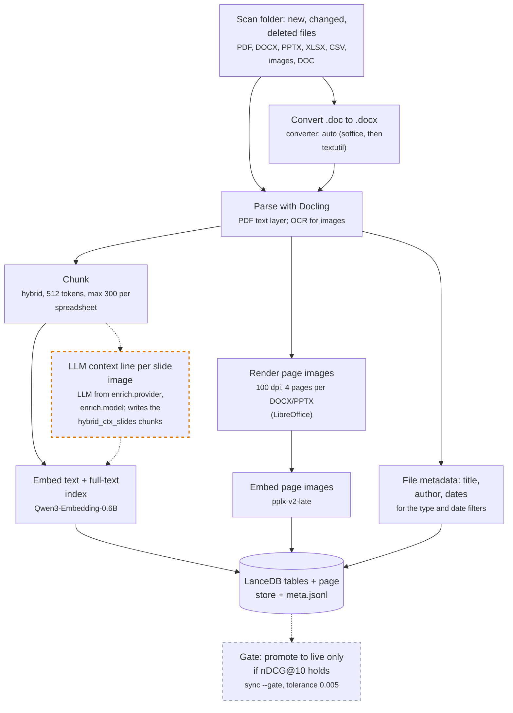
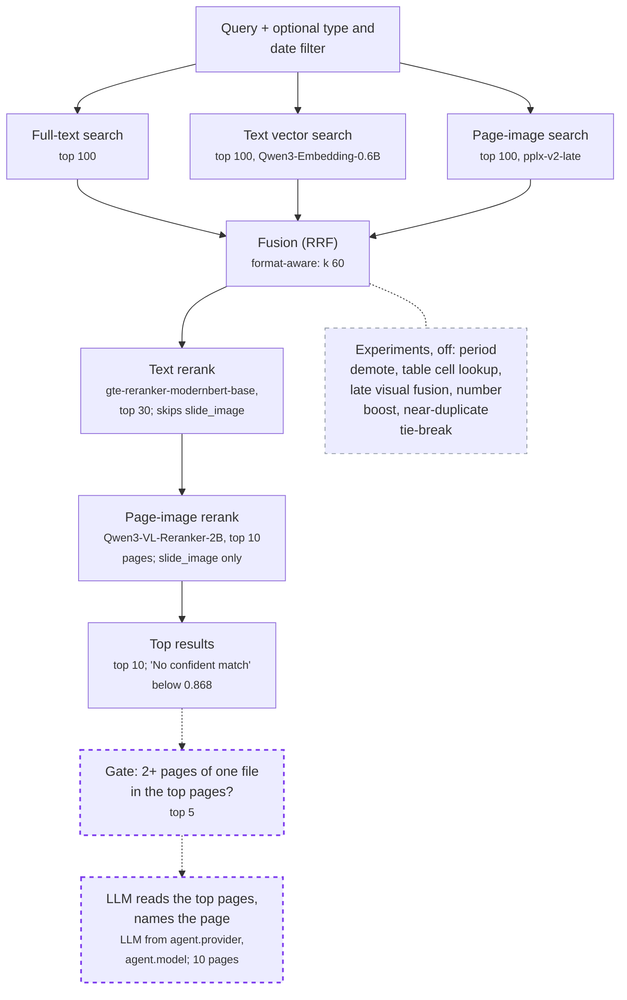

# Mixed-format document search: research report

docsearch project, October 2026. This repo holds the code, the summary tables (`results/runs.csv`, `results/`)
and the decision trail (`decisions.tsv`). The raw per-question run files (`results/runs/*.jsonl`) are not
published.

## Abstract

We built a local search and retrieval-augmented answering pipeline over a pooled folder of PDFs, slide
images, scanned images, and Office files (docx, pptx, xlsx, csv), with a default pipeline that uses only open
models with permissive licenses. Retrieval was tuned by hill-climbing: one change at a time against a locked baseline, scored on
168 labeled questions with paired bootstrap confidence intervals. The adopted configuration (Docling
structure chunks, BM25 + Qwen3-Embedding-0.6B, format-aware fusion with a visual page retriever, and the
gte-reranker-modernbert-base reranker) reaches recall@10 0.911 and nDCG@10 0.772, up from 0.861 / 0.716 for
the first baseline. The largest single gain came from visual page retrieval on slides. Those runs were on CPU,
on a subset of the corpus, so their numbers are a ranking of options. On the full corpus (an Apple-silicon laptop,
Stage 6 on), the final default (M3 + M16b + M28, see "Search phase conclusion") reaches recall@10 0.830 and
nDCG@10 0.771 on 734 public questions, and recall@10 0.919 on 87 reviewed hard-page questions.

Two notes on scope. This report covers the trials up to H2; later trials (PM1 to PM6, S1, EN1, F2) are in
`decisions.tsv` only. The headline numbers come from the original parse. A fresh parse with the locked Docling
(run `pm2_v1`, `decisions.tsv`) gives nDCG@10 0.770 on the public set and 0.826 on the hard set [measured]; expect
those when you reproduce. Phase letters (0, A to J) are listed in `results/phases.tsv`; C0 to C4 and J0 are
numbered steps inside Phase C and Phase J.

## Question

Given one folder with many file formats, which parsing, chunking, retrieval, and reranking choices find the
right page or file for a question most reliably, and which of them are cheap enough to run on a laptop?

## Data

| Source | Formats | Gold level | License |
| --- | --- | --- | --- |
| ViDoRe V3 (`vidore_v3_hr`, 14 PDFs, 1,110 pages) | pdf | page (graded 1-2) | CC-BY-4.0 |
| REAL-MM-RAG FinSlides (12 of 65 decks) | slide images | slide | CDLA-Permissive-2.0 |
| Office Comprehension Bench | docx, pptx, xlsx, csv | file | CDLA-Permissive-2.0; URL-fetched files stay under their publishers' terms (local eval only) |
| Public-domain images (Wikimedia charts, IRS/USCIS forms) | png | image | Public domain / CC0; 28 hand-written questions |

Full corpus: 629 documents, 737 questions. Every full-corpus eval scores 734: the chunker excludes oversize documents,
and `eval` drops the 3 questions whose gold documents were excluded (the `runs.csv` notes say "dropped 3 q (oversize gold
docs)"). Questions come from each dataset's own labels. OCB questions
were filtered to those that can identify their file in a pooled search (no "this document", "slide N",
formatting, or cell-address questions).

**Box subset.** The first runs used a CPU-only test machine (8 cores); embedding the full corpus (about 14.6k chunks)
would have taken many hours. We sampled, with a fixed seed: ViDoRe 30, FinSlides 60, OCB 50, images 28
questions, and kept the pages/files they reference plus twice as many distractor pages/files from the same
source. That gives 168 questions over 308 documents (300 PDF pages, 165 slides, 114 OCB files, 15 images);
office files are capped at 8 chunks each. The subset is recorded in `data/subset.json`; `--full` disables it.

| Format | Questions |
| --- | --- |
| slide_image | 60 |
| pdf | 30 |
| image | 28 |
| xlsx | 21 |
| docx | 18 |
| pptx | 8 |
| csv | 3 |

## Method

- **Hill-climbing.** One change per experiment against a locked reference; keep it only if it beats the
  reference by more than noise. Every attempt is a row in `decisions.tsv`.
- **Fixed harness.** Same questions, same corpus slice, same candidate depth (top 30 to the reranker at 384
  tokens), same fusion constant (RRF k=60). The harness was shown to be sensitive: removing the reranker
  or switching to recursive chunks produced clear, significant drops.
- **Units.** Gold is a page (`doc#pN`) for PDFs, slides, and images and a file for OCB. Retrieved chunks are
  mapped to units and de-duplicated in rank order, so different chunkers are scored on the same targets.
- **Metrics.** recall@10, nDCG@10 (graded where available), MRR@10, hit@10; overall and per format/source.
- **Statistics.** Paired bootstrap over questions (5,000 resamples, 95% CI) for every delta
  (`scripts/bootstrap_delta.py`). Adoption bar: the overall nDCG@10 CI must be above zero.

## Results

Stages 1 to 5 are measured on the box subset (168 questions, CPU). Stage 6 on is the full corpus on an Apple-silicon laptop
(734 public questions, plus the custom and hard-page sets). Deltas are vs. the reference in force at the time,
with 95% CIs.

### Stage 1: baseline and chunking

| Run | Recall@10 | nDCG@10 | MRR@10 | Notes |
| --- | --- | --- | --- | --- |
| B0 hybrid + Qwen3-Reranker-0.6B | 0.861 | 0.716 | 0.688 | first locked baseline |
| hybrid, no rerank | 0.791 | 0.647 | 0.624 | rerank gain: nDCG +0.069 [+0.030, +0.111] |
| BM25 only | 0.701 | 0.572 | 0.559 | |
| vector only (Qwen3-Embedding-0.6B) | 0.773 | 0.648 | 0.631 | |
| C1 recursive 512-token chunks + rerank | 0.728 | 0.627 | 0.610 | nDCG -0.089 [-0.134, -0.046]; rejected |

### Stage 2: rerankers (hybrid chunks, Qwen3 embeddings)

| Run | Recall@10 | nDCG@10 | MRR@10 | Rerank time (5,040 pairs) | Delta vs. B0 (nDCG) | Verdict |
| --- | --- | --- | --- | --- | --- | --- |
| Qwen3-Reranker-0.6B (B0) | 0.861 | 0.716 | 0.688 | 767 s | | |
| R1 gte-reranker-modernbert-base (149M) | 0.860 | 0.746 | 0.728 | 294 s | +0.030 [+0.002, +0.060] | adopted (B1) |
| R2 zerank-2 (4B) | 0.876 | 0.742 | 0.716 | 5,839 s | +0.026 [-0.006, +0.059]; vs. gte -0.004 [-0.033, +0.024] | rejected for CPU |

### Stage 3: embedders (gte reranker fixed)

| Run | Recall@10 | nDCG@10 | MRR@10 | Embed time | Delta vs. B1 (nDCG) | Verdict |
| --- | --- | --- | --- | --- | --- | --- |
| B1 Qwen3-Embedding-0.6B | 0.860 | 0.746 | 0.728 | 1,412 s / 1,744 chunks | | reference |
| E1 LateOn (ColBERT, 149M) | 0.831 | 0.734 | 0.721 | 385 s / 1,840 | -0.012 [-0.029, +0.003] | rejected |
| E2 pplx-embed-context-v1-0.6b | 0.866 | 0.755 | 0.738 | 1,916 s / 1,840 | +0.009 [-0.011, +0.029] | within noise; kept Qwen3 |

Without the reranker, pplx-context was better as a first stage (nDCG 0.682 vs. 0.647), but the reranker
erased most of the difference.

### Stage 4: visual page retrieval (pplx-embed-v2-late-0.6b over 705 rendered pages)

| Run | Recall@10 | nDCG@10 | MRR@10 | Delta vs. B1 (nDCG) | Verdict |
| --- | --- | --- | --- | --- | --- |
| visual only (no rerank) | 0.806 | 0.783 | 0.794 | +0.038 [-0.031, +0.105] | reference point |
| V1 plain RRF fusion + gte | 0.798 | 0.675 | 0.653 | -0.071 [-0.116, -0.029] | rejected |
| V2 format-aware fusion + gte | 0.899 | 0.761 | 0.734 | +0.015 [-0.003, +0.033] | not adopted alone |
| V2b V2 + skip rerank for near-empty text | **0.911** | **0.772** | **0.744** | **+0.026 [+0.005, +0.046]** | **adopted** |

Per format, visual-only vs. B1: slide_image nDCG +0.330 [+0.244, +0.419], pdf +0.066 [+0.003, +0.144], xlsx
recall -0.714 (spreadsheets are not rendered). V2b vs. B1: slide_image nDCG +0.060 [+0.015, +0.108], pdf
+0.028 [+0.006, +0.054], spreadsheets unchanged.

Costs: rendering 705 pages took 314 s; embedding them took about 54 min (3.5-5 s/page on CPU); the fused
eval with reranking took 22-43 s for 168 questions.

### Stage 5: chunking challengers (V2b fixed)

| Run | Recall@10 | nDCG@10 | MRR@10 | Delta vs. V2b (nDCG) | Verdict |
| --- | --- | --- | --- | --- | --- |
| C2 structure-aware spreadsheet chunks (sheet, summary, header) | 0.899 | 0.768 | 0.743 | -0.004 [-0.020, +0.008]; xlsx (n=21) -0.007 [-0.125, +0.081] | rejected |
| C3 PDF chunks 384 tokens + 64 overlap | 0.915 | 0.778 | 0.753 | +0.007 [-0.001, +0.015]; pdf (n=30) +0.034 [-0.006, +0.076] | not adopted; recheck on full corpus |

### Stage 6: full corpus on an Apple-silicon laptop (MPS, n=734 questions)

Same code and settings as the CPU machine, whole corpus (`--full`). Numbers are recall@10 / nDCG@10 /
MRR@10. Bootstrap CIs were not computed for these runs (the per-query files are not published).

| Run | recall@10 | nDCG@10 | MRR@10 |
| --- | --- | --- | --- |
| **M3 (adopted): V2b + no rerank for slide_image** | 0.817 | **0.709** | **0.699** |
| M4 (not adopted): M3 + `visual.blind_formats: [pptx, csv]` | 0.815 | 0.708 | 0.698 |
| M5 (rejected): M3 with reranker Qwen3-Reranker-4B | 0.817 | 0.701 | 0.690 |
| V2b (`all --full`): format-aware visual fusion + gte | 0.819 | 0.695 | 0.680 |
| V2b without rerank | 0.813 | 0.682 | |
| hybrid + gte (`eval --full`) | 0.771 | 0.681 | 0.676 |
| hybrid, no rerank | 0.719 | 0.587 | |
| BM25 only | 0.610 | 0.515 | |
| vector only | 0.682 | 0.563 | |

- The CPU-phase conclusions held at full size: visual fusion adds +0.048 recall@10 over hybrid+gte, and the
  reranker adds +0.094 nDCG@10 on the text pipeline (0.681 vs 0.587).
- Absolute scores are lower than on the box subset (0.695 vs 0.772 nDCG), as expected with ~2x more
  distractors per question and every page of every document indexed.
- Regression: on slides the reranker hurt, slide_image nDCG@10 0.555 with rerank vs 0.603 without (M2).
- M3 fixed it with one change: slide_image candidates skip the gte rerank and keep their fused rank
  (`search.rerank_skip_formats: [slide_image]`). Paired bootstrap vs V2b, n=734: nDCG@10 +0.0142
  [+0.0023, +0.0262], MRR@10 +0.0189 [+0.0056, +0.0322], recall@10 -0.0014 [-0.016, +0.014]. Slides
  (n=223): nDCG +0.0469 [+0.0086, +0.0866], MRR +0.062. Every other format: no change, as designed
  (only slide candidates are touched). Adopted: the overall nDCG CI is above zero.
- MPS timings: index text 1512 s, render 501 s, index pages 1578 s, eval 518 s.

### Stage 7: custom harder questions (M6, laptop full corpus)

133 LLM-drafted questions (Grok CLI), reviewed (keep/edit) by a reviewer against the full cited chunks, run with the
M3 default (`eval --full --questions custom --reviewed-only`, run `m3_questions_custom`).

| Type | n | recall@10 | all@10 | nDCG@10 |
|---|---|---|---|---|
| image (chart / table values) | 63 | 0.952 | - | 0.901 |
| multi_doc (2+ docs) | 27 | 0.902 | 0.815 | 0.829 |
| no_answer | 43 | abstain 0.465 at top rerank score < 0.868 (p10 of answerable); answerable false-abstain 0.107 | | |
| overall (answerable) | 90 | | | 0.879 |

Reading: overall nDCG 0.879 is far above the public set's 0.709, so these questions are easier, not harder
[measured]. Likely cause: drafted questions reuse the wording of the chunk they came from, which BM25 and the
reranker match directly [inferred]. Multi-doc all@10 0.815 is the one hard-ish signal: about 1 in 5 multi-doc
questions misses a required page. A score threshold separates no-answer questions poorly (abstains on less than
half while wrongly abstaining on 11% of answerable ones). Next: an LLM answerability judge for abstention and a
paraphrase pass (`custom_para`) that removes copied n-grams, each measured as one change.

### Stage 8: abstention judge and paraphrased questions (M7, M8)

| Run | Change vs reference | Result | Verdict |
|---|---|---|---|
| M7 | LLM judge (Grok CLI) reads the top-5 reranked chunks and says ANSWERABLE/NOT, vs the rerank-score threshold | abstain 0.977 vs 0.465; false-abstain 0.189 vs 0.107; 0 failed calls; answerable verdicts citing a gold page 0.973 | Much better at spotting no-answer questions, but wrongly abstains on 19% of answerable ones. Gate it on the score (M9) |
| M8 | Paraphrase every kept question (no copied 4-gram from the gold chunks) | paired n=90: nDCG@10 -0.034 [-0.087, +0.014], recall@10 -0.019 [-0.063, +0.022]; image -0.033, multi_doc -0.037, all@10 0.815 -> 0.778 | Wording overlap is not the main reason the custom set is easy (CIs include zero) |
| M9 | Gated: trust a top rerank score >= gate, ask the judge only below it (offline sweep of the M7 verdicts) | gate 0.888: abstain 0.605, false-abstain 0.089, judge on 41% of questions | Best point with false-abstain <= the threshold's 0.107; tuned in-sample on 133 questions, so re-check it on the next set |

Conclusion [measured + inferred]: the custom questions are easy because the pages they come from are easy to
retrieve, not because of copied wording. The next harder set should sample hard pages on purpose: near-duplicate
slides (same deck, different quarter), dense tables (statistical annexes, spreadsheets), and pages that score low
in retrieval for their own labeled questions.

### Stage 9: hard-page set (M10 baseline)

| Run | Set | Result |
|---|---|---|
| M10 | M3 default on `questions_hard.jsonl`, reviewed only (n=87) | nDCG@10 0.828, recall@10 0.919. near-dup (n=35): recall 0.886, nDCG 0.742; table (23): nDCG 0.845; missed (18): 0.924; pair (11): 0.913 |

Near-duplicates are the weakest type. Of the 13 near-dup questions where the target page was not ranked
first, 10 had same-document twin pages above it: 8 statistical-annex PDF pages that differ only in the
values (the question's cue number, e.g. "whose 2022 rate was 32.7", is on the target page only), and 2 pptx
pages. The other 3 are IBM slides, which M3 does not rerank. Challengers: M11 (a tie-break on query terms
that only a few of the top candidates contain) and M12 (document name + page number in the reranker input,
with slides reranked again).

| Run | Change vs M3 | Hard set (n=87) | Public set (n=734) | Verdict |
|---|---|---|---|---|
| M11 | `--distinct-boost 2`: move a top candidate up 2 places per query term few top candidates contain | nDCG +0.002 [-0.020, +0.026]; near-dup +0.005 | nDCG -0.021 [-0.029, -0.013]; slide_image -0.053 | Rejected |
| M12 | `--rerank-context`: doc name + page in the reranker input, slides reranked again | nDCG -0.014; pair -0.061 (CI < 0); table -0.043 | nDCG -0.011 [-0.023, +0.0004]; MRR -0.018 (CI < 0); slide_image -0.026; xlsx -0.007 (CI < 0) | Rejected |

Conclusion [measured]: telling twin pages apart is not fixed by a lexical boost or by giving the reranker
document/page context; both cost the public set. Remaining candidates are exact matching of the numbers in
the question against page values, or a model that compares candidate pages with each other. M3 stays the
default. Note: the M11 hard-set run also wrote a reference run on the 168-question box subset (the reference
lookup missed for that scope); that row in runs.csv is not a full-corpus reference and should be ignored.

### Stage 10: PDF failure analysis and post-rerank ordering (M13b, M14b)

Of 182 PDF items (150 public, 32 hard), 30 had the gold page outside the M3 top 3. Buckets (a question can
be in several): 28 reached the top-30 candidates but were reranked below 3 (in 13 the visual channel had the
page in its top 3; in 8 fusion had it top 3 before the rerank); 16 gold pages split into many chunks with table
markup; 13 queries contained exact numbers found on the gold page; 2 missed by retrieval; 1 bad parse; 1
missed by the visual channel; 0 figure-only, near-duplicate-by-overlap or chunk-length cases.

| Run | Change vs M3 | Hard set (n=87) | Public set (n=734) | Verdict |
|---|---|---|---|---|
| M13b | `--late-visual-formats pdf`: after rerank, re-fuse PDF pages with their visual rank, only within PDF slots | nDCG -0.025; table -0.106 (CI < 0) | nDCG -0.0017 [-0.0055, +0.0023]; pdf -0.008; non-PDF formats exactly 0 | Rejected |
| M14b | `--number-boost 2`: PDF page up 2 page slots per distinctive query number on it, within PDF slots | nDCG -0.008 (CI < 0) | nDCG -0.0012; pdf -0.0077 [-0.013, -0.003]; slide_image +0.0012 | Rejected |

M13 and M14 (first versions) were bugs, not results: M13 sorted the whole top 30, so the visual bonus lifted
PDFs over non-PDF golds (docx -0.063, image -0.219); M14 moved single chunks 2 slots while pages hold ~3.6
chunks, so it changed 13 top-10s and no metric. The b versions fix both.

M14b slide_image note [measured]: slides are not counted as pdf (format `slide_image` is never boosted). The
+0.0012 comes from two FinSlides questions (finslides:113, finslides:201) whose gold moved within ranks 8-10:
regrouping a PDF page's chunks together changes how many distinct units sit above a slide in the top 30, a
small unit-rank side effect of the slot reordering, not a scope leak.

Conclusion [measured]: post-rerank ordering tweaks are exhausted (M11, M12, M13b, M14b all rejected). M3
stays the default. The remaining lever for PDFs is table-aware PDF chunking (keep tables whole, headers
repeated), which needs a re-chunk and re-index.

### Stage 11: table-aware PDF chunking (M15)

| Run | Change vs M3 | Hard set (n=87) | Public set (n=734) | Verdict |
|---|---|---|---|---|
| M15 | `--pdf-tables` (`chunks_hybrid_pdftable`): PDF table-only chunks replaced by whole tables, split by rows with header + caption + section + page repeated; everything else verbatim | nDCG -0.017 [-0.064, +0.027]; near-dup recall +0.057 | nDCG -0.0017 [-0.006, +0.003]; pdf nDCG +0.0066 [-0.004, +0.018], pdf recall +0.0105 | Not adopted |

Non-PDF formats shift slightly because the new PDF table chunks compete in the shared ranking (their own
chunks are byte-identical). The gain on PDFs is inside noise. The `chunks_hybrid_pdftable` table is kept
(cheap: about 1 min to chunk, minutes to embed) for later tests. Docling also detects tables of contents as
tables, so some table chunks have numbered column headers instead of real ones.

### Stage 12: vision page reranker and rerank-window cap (M16, M16b, M17)

Search was reopened on 2026-10-11 with six ideas from an outside review. Two were run.

Where M3 loses, public set [measured]: the gold page or file is first for 61% of questions, in the top 3 for
75%, in the top 10 for 87%. Before the rerank it is in the first 30 units for 94% and in the first 100 for 96%.

| Format (n) | Gold first | Top 3 | Top 10 | First 30 chunks, before rerank | First 30 units | First 100 units |
|---|---|---|---|---|---|---|
| all (734) | 0.614 | 0.753 | 0.865 | 0.880 | 0.937 | 0.962 |
| slide_image (223) | 0.417 | 0.623 | 0.794 | 0.937 | 0.942 | 1.000 |
| pdf (150) | 0.667 | 0.867 | 0.960 | 0.967 | 0.993 | 1.000 |
| docx (149) | 0.852 | 0.913 | 0.966 | 0.926 | 1.000 | 1.000 |
| xlsx (135) | 0.556 | 0.659 | 0.770 | 0.696 | 0.822 | 0.837 |
| pptx (35) | 0.571 | 0.629 | 0.800 | 0.657 | 0.886 | 0.943 |
| csv (14) | 0.571 | 0.643 | 0.714 | 0.643 | 0.714 | 0.714 |

- PDFs and slides are a ranking problem: the page is retrieved, then ordered badly.
- Slides: 214 of 223 questions name a year or a quarter. Of 130 with the gold slide not first, the first slide
  is from another deck in 34 and from the same deck in 96.
- Spreadsheets: 26 questions (22 xlsx, 4 csv) never retrieve their file. They point at 12 files; three have 1
  chunk in the index and four are cut at the 300-chunk cap. Many of these questions do not say which file they
  mean ("Give me a summary of the table?") [inferred, from reading them; not all labelled].
- File-level formats fill the 30-chunk rerank window with many chunks of one file (pptx: gold in the first 30
  units 0.886, in the first 30 chunks 0.657). This is the reason for M17.

| Run | Change vs M3 | Hard set (n=87) | Public set (n=734) | Verdict |
|---|---|---|---|---|
| M16 | `--page-reranker qwen3-vl-2b` (Qwen3-VL-Reranker-2B, Apache-2.0): after the text rerank, the top 10 pdf + slide pages are reordered by the model's score for the question and the page image, within their own slots | nDCG -0.020 [-0.064, +0.026]; near-dup +0.051; table -0.114 [-0.221, -0.016] | nDCG +0.042 [+0.029, +0.056]; slide_image +0.155 [+0.121, +0.192]; pdf -0.025 [-0.057, +0.006], pdf recall -0.023 [-0.045, -0.002] | Not adopted as declared (hard tables fall) |
| M16b | the same, `--page-rerank-formats slide_image` (slides only) | nDCG +0.004 [-0.021, +0.032]; near-dup +0.034; missed -0.041 [-0.103, 0]; pdf and table exactly 0 | nDCG +0.047 [+0.036, +0.059] (0.819 / 0.756 / 0.760); slide_image +0.155 [+0.121, +0.192]; every other format exactly 0 | **Passes the adoption bar for slides.** Default not changed in this row (adopted in M18): the reranker runs in `eval` only, and it adds about 12 to 14 s per query |
| M17 | `--rerank-unit-chunks 2`: a page or file puts at most 2 chunks in a row in the fused list | nDCG +0.033 [-0.007, +0.079]; table +0.096 [0, +0.213]; near-dup recall -0.057 | nDCG -0.0001 [-0.009, +0.009]; pptx +0.075 [+0.016, +0.146]; xlsx -0.014 | Not adopted |

M16 on slides [measured]: the gold slide is first for 69.5% of the 223 public slide questions (41.7% with M3)
and in the top 3 for 79.4% (62.3%). The gold moved up in 76 questions and down in 10. The top 10 holds the
same slides in almost every case (0.794 to 0.798), so the gain is order, not retrieval.

M16 on PDFs [measured]: gold first stays at 66.7%; the gold moved up in 25 questions and down in 30. On the
hard set it took 7 table pages off rank 1. A re-score of the 10 changed hard PDF questions at 200 dpi (2.6 M
pixels, 7 s per page) moved the gold up in 5 and to rank 1 in 1; twin table pages score within 0.1 of each
other. The 2B model judges the topic of a page, not the values in a table; resolution is not the main cause.

Limits of the M16 result:
- All 223 public slide questions come from one source (FinSlides: 12 IBM earnings decks). The hard-set slide
  questions (n=28, written to name their target) start at nDCG 0.896 and gain +0.013, inside noise.
- Cost [measured]: about 1.2 to 1.4 s per page on MPS, so about 12 to 14 s per query for 10 pages; 4.3 GB of
  weights.
- Looks, not results (6 settings replayed from cached scores): the vision rank as one more RRF vote on top of
  the current rank, in place of a replacement. On the hard set the vote looked better for slides (+0.014
  [+0.002, +0.031], k=10). The public set did not agree: slides +0.068 [+0.051, +0.086] with the vote, +0.155
  with the replacement; PDFs -0.012 (k=10) and -0.009 (k=2), intervals include zero. The vote is not the repair
  for PDFs, and for slides the plain vision order is better.

### Stage 13: a list of ideas, slides first (M18 to M21)

Reference from here on: the new default M3 + M16b (public 0.819 / 0.756 / 0.760; hard 0.919 / 0.832 / 0.808).

| Run | Change vs the default | Hard set (n=87) | Public set (n=734) | Verdict |
|---|---|---|---|---|
| M18 | M16b made the default; wired into `search` and `answer` | equal to M16b | equal to M16b | Adopted (2026-10-12) |
| M19 | `--page-rerank-pages 30`: the vision reranker sees 30 slides, not 10 | nDCG -0.009 [-0.019, -0.001]; 4 of 87 questions, all slides, each down 1 or 2 places | nDCG +0.037 [+0.024, +0.051]; slides +0.121 [+0.079, +0.164]; slide gold in the top 10 0.798 to 0.937, first 0.695 to 0.794; other formats exactly 0 | Not adopted (2026-10-14): the hard set falls. The flag stays as an option for slide folders on a GPU. About 40 s per slide search on the laptop |
| M20 | `--visual-weights slide_image=2`: a slide's visual rank counts double in the fusion | nDCG -0.023 [-0.047, -0.005] | nDCG -0.018 [-0.036, +0.001]; slides +0.108; xlsx -0.117, docx -0.105, pptx -0.051 (all CI < 0) | Rejected |
| M21 | `--period-demote`: files named for another quarter than the query's go behind the rest | nDCG -0.007 [-0.017, 0] | nDCG -0.003 [-0.017, +0.012]; slide gold first 0.695 to 0.668 | Not adopted |

M19 and M20 lift slides by about the same amount, and they differ in who pays. M20 moves slides up in the shared
list, so Excel, Word and PowerPoint files fall: the fusion is zero-sum across formats (finding 7). M19 leaves the
fused list alone and reorders slides only among the slots slides already hold, so no other format moves.

### Stage 14: Office pages, scanned PDFs, a text-only pipeline, and a production embedder (M22 to M26)

Reference: the default M3 + M16b. Each row is one change, declared before the run.

| Run | Change vs the default | Hard set (n=87) | Public set (n=734) | Verdict |
|---|---|---|---|---|
| M23 | every Office page rendered for the page-image model, not the first 4 (4,963 page images) | exactly 0 | nDCG -0.001 [-0.009, +0.008]; pptx +0.144 [+0.053, +0.247]; xlsx -0.037 [-0.061, -0.015] | Not adopted: zero-sum again |
| M24 | `--office-shared-pages 4`: the first 4 pages compete with other formats; all pages order docx/pptx files among the slots Office files hold | exactly 0 | nDCG +0.005 [-0.003, +0.012]; pptx +0.109 [+0.030, +0.202]; docx -0.003 [-0.031, +0.027], 16 of 149 questions moved (6 up, 10 down) | On hold: Word is the main type of the target mix |
| M24b | `--office-own-formats pptx`: the same for pptx only | exactly 0 | nDCG +0.002 [-0.000, +0.006]; pptx +0.043 [-0.004, +0.119]; docx, xlsx, pdf: no question moved | Not adopted |
| M25 | `--visual-text-rich 200`: a page picture votes only for a page with under 200 characters of text | nDCG +0.009 [-0.034, +0.050] | nDCG -0.026 [-0.039, -0.014]; xlsx -0.057, docx -0.038, slides -0.029, pdf -0.019 | Rejected |

**Scanned PDFs (M22).** `scripts/scan_pdfs.py` makes test copies of the 14 PDFs with the text layer removed
(200 dpi page pictures): every page, or every odd page. `ingest.pdf_ocr` turns on Docling's OCR for the
regions of a page that have no text layer (RapidOCR). PDF questions only; gold first / gold in the top 10
[measured]:

| State of the 14 PDFs | Public (n=150), default | Public, text-only | Hard (n=32), default | Hard, text-only |
|---|---|---|---|---|
| Typed (as shipped), OCR off | 67% / 96% | 67% / 96% | 59% / 78% | 66% / 97% |
| Typed, OCR on | 67% / 97% | 66% / 96% | 59% / 72% | 66% / 94% |
| Every odd page scanned, OCR off | 45% / 75% | 44% / 72% | 25% / 38% | 34% / 47% |
| Every odd page scanned, OCR on | 67% / 97% | 67% / 95% | 56% / 69% | 66% / 84% |
| Every page scanned, OCR off | 0% / 27% | 0% / 0% | 0% / 22% | 0% / 0% |
| Every page scanned, OCR on | 66% / 95% | 65% / 95% | 50% / 62% | 53% / 81% |

"Text-only" is the default with page pictures and the vision reranker off: keywords, text embedding, and the
text reranker.

- OCR brings a half-scanned PDF back to the level of a typed one on the public set.
- A fully scanned PDF with OCR is 1 point under a typed one on the public set (gold first 66% against 67%,
  top 10 95% against 96%; pdf nDCG -0.038 [-0.071, -0.007] and recall@10 -0.050: fewer of a question's
  several gold pages are found). On the hard set it loses more: top 10 78% to 62% with page pictures (pdf nDCG -0.118 [-0.254,
  +0.006], n=32). Likely cause: the hard questions turn on exact values in look-alike tables, and OCR text is less exact
  [inferred].
- With OCR on, page pictures add nothing for a scanned PDF on the public set (text-only 65% / 95%), and
  text-only is ahead on the hard set (pdf nDCG +0.094 [+0.020, +0.184], with the caveat below).
- Without OCR, the page-image model finds a scanned page in the top 10 for about a quarter of the questions
  and never puts it first. A text-only pipeline finds nothing.
- OCR on typed PDFs: public +0.001 [-0.000, +0.002] over all questions; hard -0.007 [-0.017, 0], and hard PDF
  top 10 78% to 72%. Region OCR also reads charts and pasted images on typed pages, and that changes a few
  chunks. The flag stays off by default.
- Cost on the laptop: 1.1 s per page without OCR; 2.7 to 3.5 s per page with it on typed and half-scanned
  files; 4.2 s per page on fully scanned files (1,065 pages). OCR found text on 1,046 of those 1,065 pages.
- Crash guard: RapidOCR ended the Python process (segfault) on one page of one fully scanned file. With
  `ingest.pdf_ocr` on, each PDF is parsed in a child process (`ingest.parse_pdf_isolated`): region OCR, then
  full-page OCR, then no OCR. A crash becomes an exit code for that file, and the ingest run goes on.
  In the full run, 13 of 14 files parsed in region mode and 1 needed full-page OCR; none was lost.

**A text-only pipeline for a mix with no slide images.** Stored runs, public set, an even mix of docx, pdf,
pptx and xlsx (gold first / top 10) [measured]: keywords + embedding 61% / 85%; with the text reranker 71% /
88%; the full M3 pipeline with page pictures 66% / 87%. Per format, text-only with the reranker against the
default: docx 85 / 97 against 85 / 97; pdf 67 / 96 against 67 / 96; pptx 77 / 86 against 57 / 80; xlsx 54 /
73 against 56 / 77. Slide images need the pictures: 33 / 67 against 70 / 80. So for a mix of Word, PDF,
PowerPoint and Excel files the page-image channel adds nothing overall, and the text reranker is the piece
that matters (pdf gold first 49% without it, 67% with it).

On the hard set, text-only has the gold PDF page in the top 10 for 31 of 32 questions, the default for 25 of
32 (nDCG +0.127 [+0.022, +0.247]). This is a lead, not proof: an LLM drafted the hard questions from page
text only, and 5 of the 32 were picked from M3's misses (without them: 26 of 27 against 21 of 27; gold first
16 against 15 of 27).

**A production text embedder (M26).** `mixedbread-ai/mxbai-embed-large-v1` (Apache-2.0, 335M, 512 tokens,
English) in place of Qwen3-Embedding-0.6B, in the text-only pipeline, with its own index
(`DOCSEARCH_MODELS_EMBEDDER`, `DOCSEARCH_PATHS_INDEX_DIR`). The judged setting, declared before the run, is
keywords + embedding + gte reranker. Gold first / top 10 [measured]:

| Text-only pipeline | Public, even mix of docx, pdf, pptx, xlsx | Hard set (n=87) | nDCG@10, mxbai against Qwen3 |
|---|---|---|---|
| Qwen3 + keywords + reranker | 70% / 88% | 74% / 97% | |
| mxbai + keywords + reranker (judged) | 71% / 85% | 70% / 94% | public -0.004 [-0.016, +0.008]; hard -0.017 [-0.052, +0.019] |
| Qwen3 + keywords | 61% / 85% | 66% / 90% | |
| mxbai + keywords (a look) | 62% / 84% | 52% / 87% | public +0.002 [-0.011, +0.016]; hard -0.077 [-0.137, -0.020] |
| Qwen3 alone | 59% / 83% | 57% / 83% | |
| mxbai alone (a look) | 59% / 80% | 41% / 76% | public +0.008 [-0.016, +0.031]; hard -0.115 [-0.205, -0.025] |

- With the reranker, mxbai ties Qwen3 on both sets. Per format on the public set (first / top 10): docx 85 /
  95, pdf 67 / 95, pptx 77 / 80, xlsx 53 / 70, against 85 / 97, 67 / 96, 77 / 86, 53 / 73.
- Without the reranker, mxbai is worse on the hard set, most on spreadsheets (xlsx nDCG -0.312 [-0.509,
  -0.131], n=12). The reranker hides most of the gap between the two embedders.
- The chunks were sized for Qwen3: 1,131 of 14,616 chunks (7.7%; xlsx 20%, docx 11%) are longer than 512
  mxbai tokens and were cut. A set-up that chunks at about 450 tokens was not tried.
- The lead-in sentence (M26b, a look). The model card asks for "Represent this sentence for searching relevant
  passages: " before each question. The model's files declare it and `Embedder.queries` applies it, so every
  M26 run sent it. With bare questions in its place, nDCG@10 moves by +0.002 [-0.003, +0.007] on the public set
  and +0.012 [0, +0.031] on the hard set with the reranker; 0.000 and +0.001 without it; +0.003 [-0.005, +0.011]
  and +0.029 [+0.007, +0.055] for the embedding alone [measured]. The lead-in does not matter on these
  questions. A production caller may send either form.

### Stage 15: spreadsheets (M27, M28)

**M27.** `--variant hybrid_tbl` on the full corpus (C2 from the CPU phase): each xlsx/csv chunk carries the file,
the sheet, a summary of the columns, the row count and sample values, and the header. Public nDCG -0.001
[-0.010, +0.007]; xlsx +0.014 [-0.025, +0.053] (gold first 56% to 59%, top 10 77% to 76%); docx -0.012
[-0.026, -0.001]; hard -0.010 [-0.023, 0], hard xlsx gold first 92% to 75% (n=12). Not adopted.

**Why the default misses 31 of the 135 Excel questions** (sorted by hand) [measured counts, the sort is a
judgement]:

| Cause | Questions | Example |
|---|---|---|
| The question gives no way to tell the file | 15 | "Generate a summary of this table"; "What is the standard deviation of the sales column?" |
| It asks about a workbook feature that the parsed text does not hold | 10 | hidden sheets, slicers, freeze panes, hyperlinks, chart legends, cell formats |
| It asks for content that the 300-chunk cap cut out of the index | 6 | "What are medicines that include Acebrophylline (100mg)?" |

The first two causes are limits of the test set and of the parser, not of the ranking: these questions were
written for a chat with one open file. The third is an indexing fault. `Multiple tables_Improved.xlsx` has 9
tables; the first (3,268 rows) took all 300 chunks, so the sheets Astronauts, Mobile phone carriers and
Medicine details were not indexed. 17 questions point at that file and 11 miss the top 10.

**M28.** `--variant hybrid_sheets`: a file over the cap gives each of its tables one more chunk in turn
until the cap is used (`chunk.share_cap`). Only 2 of the 66 spreadsheet files change; every other chunk is
identical. Declared before the run, with the note that a gain would rest on one workbook.

| Set | Default | M28 | nDCG@10 change |
|---|---|---|---|
| Public, all (n=734) | 0.819 / 0.756 / 0.760 | 0.830 / 0.771 / 0.775 | +0.015 [+0.006, +0.025] |
| Public, xlsx (n=135), gold first / top 10 | 56% / 77% | 64% / 84% | +0.079 [+0.033, +0.131] |
| Hard (n=87) | 0.919 / 0.832 / 0.808 | the same | exactly 0 |

Other formats on the public set: pptx +0.018 [0, +0.054]; docx -0.003 [-0.008, 0]; pdf -0.001; csv -0.002.
The 17 questions on the capped workbook go from 6 to 16 in the top 10, and from 1 to 14 gold first; they are
15 of the 33 questions that moved. In the text-only pipeline (a look) xlsx goes from 53% / 73% to 61% / 83%.
M28 passes the bar. The gain is one workbook, and the fix was designed after a look at its misses, so it is
a repair of an indexing fault and not evidence for other folders.

**M31: M28 adopted (2026-10-13).** The `hybrid` variant now shares the cap over the tables of a big
spreadsheet. The re-chunked corpus equals the `hybrid_sheets` chunks, and the new default runs
(`m28_default[_hard]`) equal the M28 runs on every question [measured]. New default, public: 0.830 / 0.771 /
0.775; all 734, gold first / top 3 / top 10: 71% / 82% / 88%; xlsx 64% / 74% / 84%. Hard set unchanged.

### Stage 16: EmbeddingGemma 2, for text and for page pictures (M29, M30)

`google/embeddinggemma-2` (released 2026-10-06; Apache-2.0, not gated, plus the Gemma Prohibited Use Policy (see THIRD-PARTY.md); 740M parameters, 270M of them for
text; 768 dimensions; 8,192 tokens; one vector for a text, a picture, or both). The older
`embeddinggemma-300m` was never run: it is gated and has the Gemma licence. The model card forbids float16,
so every run here uses float32. The model declares a lead-in for documents as well as for questions;
`Embedder.docs` now sends a declared document lead-in (a no-op for Qwen3 and mxbai).

**M29, text embedder.** The M26 test again: text-only, keywords + embedding + gte reranker, own index
(`work/index_egemma2`, 826 s for 14,616 chunks against 2,338 s for mxbai; no chunk is cut). The judged
setting, declared before the run, is against the same pipeline with Qwen3. Gold first / top 10 [measured]:

| Text-only pipeline with the reranker | Public, even mix of docx, pdf, pptx, xlsx | Public, all (n=734) | Hard set (n=87) |
|---|---|---|---|
| Qwen3-Embedding-0.6B | 70% / 88% | 55% / 78% | 74% / 97% |
| mxbai-embed-large-v1 | 71% / 85% | 56% / 76% | 70% / 94% |
| EmbeddingGemma 2 | 70% / 88% | 56% / 80% | 72% / 94% |

- Against Qwen3: public nDCG@10 +0.014 [+0.002, +0.025]; hard -0.002 [-0.037, +0.036]. The public gain is the
  text of slide images (+0.048 [+0.020, +0.077]); docx, pdf, pptx and xlsx each tie. The default pipeline
  finds slide images by page pictures, so this run does not show a gain for the default.
- Looks: without the reranker public +0.026 [+0.013, +0.039], hard -0.037 [-0.083, +0.008]; the embedding alone
  public +0.042 [+0.022, +0.064], hard +0.037 [-0.018, +0.092]; against mxbai with the reranker public +0.017
  [+0.005, +0.029], hard +0.014 [-0.014, +0.043].
- The mxbai lead-in (M26b, Stage 14) and this stage give the same advice for production: send what the
  model's files declare, and for EmbeddingGemma 2 use float32 or bfloat16.

**M30, page-picture model.** `models.embedders.egemma2` (`vectors: single`, `visual.PageVectorEncoder`): one
vector for each page picture at the model's default 280 image tokens; 1,892 pages in 636 s. The judged
setting, declared before the run, is the default pipeline with this model in place of pplx-embed-v2-late.
Gold first / top 10 [measured]:

| Pipeline | Public, all | docx | pdf | slide images | Hard, all | Hard pdf | nDCG@10 against the default |
|---|---|---|---|---|---|---|---|
| Default (pplx-v2-late pages) | 70% / 87% | 85 / 97 | 67 / 96 | 70 / 80 | 75% / 92% | 59 / 78 | |
| M30: EmbeddingGemma 2 pages (judged) | 67% / 84% | 75 / 90 | 65 / 93 | 67 / 77 | 66% / 83% | 44 / 62 | public -0.030 [-0.045, -0.016]; hard -0.097 [-0.162, -0.040] |
| One model for text and pictures + keywords + gte reranker (a look) | 57% / 86% | 74 / 92 | 65 / 93 | 35 / 82 | 64% / 84% | 44 / 66 | public -0.080 [-0.101, -0.060]; hard -0.105 [-0.182, -0.032] |
| The same with no reranker (a look; a one-model design) | 53% / 85% | 72 / 92 | 55 / 90 | 35 / 82 | 52% / 79% | 19 / 56 | public -0.111 [-0.134, -0.089]; hard -0.205 [-0.283, -0.127] |

- Rejected. Page pictures alone (a look): EmbeddingGemma 2 against pplx-v2-late public -0.143 [-0.165, -0.122],
  hard -0.202 [-0.280, -0.131]; hard pdf gold first 3% against 50%. One vector at 280 image tokens holds less of
  a page than the token vectors of a late-interaction model.
- **M30c (a look): 1,120 image tokens, the most the card allows** (`--visual egemma2-1120`, 2.2 s per page
  against 0.3 s). Against the new default (M3 + M16b + M28): public -0.037 [-0.052, -0.022], gold first / top 10
  68% / 86%; hard -0.082 [-0.150, -0.022], 67% / 84%. Pictures alone, 1,120 against 280 tokens: public -0.025
  [-0.042, -0.008] (Word and PDF down, scans and photos +0.098); hard +0.007 [-0.042, +0.059]; hard pdf gold
  first 6% against 3% (50% for pplx-v2-late). More detail does not close the gap: one vector per page is the
  limit. Not tried: page renders at a higher resolution (the 1,280-pixel renders are upsampled at 1,120 tokens).
- **M32: the 8B vision reranker on PDF pages and slides** (`--page-reranker qwen3-vl-8b --page-rerank-formats pdf
  slide_image`, the M16 setting with a model 4 times larger; item 7). Against the default: public +0.003 [-0.003,
  +0.010]; PDF gold first 67% -> 72%, but 23 PDF questions went down and 27 up, nDCG +0.006 [-0.022, +0.033];
  hard -0.015 [-0.059, +0.027], tables -0.125 [-0.221, -0.039], hard PDF gold first 19 -> 15 of 32 (the 2B: 15).
  8B against 2B (a look): public PDF +0.030 [+0.007, +0.055], hard PDF -0.016. Rejected. The larger model is
  better than the 2B, but not better than no vision reranker on PDFs, and it still loses look-alike table pages.
  A model that scores one page at a time does not separate pages that differ only in their values, at 2B or 8B.
  Cost: about 17 GB of memory; 2 s per page with memory free, up to 30 s while the 32 GB laptop swapped. Its
  `modules.json` names a folder it does not ship; `models.fixed_modules_dir` loads it.
- For docx, pdf, pptx and xlsx the best pipeline is still text-only with a reranker (Stage 14), with either
  Qwen3 or EmbeddingGemma 2 as the embedder.
- An operations fault found on the way: with no network, transformers lists no `additional_chat_templates`
  when the cached snapshot lacks any file of the repo, and Qwen3-VL-Reranker then failed on the first page it
  had to score live. `models.named_chat_template` reads the template from the cache; offline live scores equal
  the saved scores on 6 pages. A server with no internet access would have met the same fault.

## Search phase conclusion

**Final default:** M3 (hybrid chunks, Qwen3-Embedding-0.6B + BM25, format-aware fusion with the
pplx-embed-v2-late page-image channel, gte-reranker-modernbert-base on the top 30, slides not reranked) plus
M16b (Qwen3-VL-Reranker-2B reorders the top 10 slide pages; adopted 2026-10-12, Stage 13) plus M28 (a big
spreadsheet shares its chunk cap over its tables; adopted 2026-10-13, Stage 15) plus, as an opt-in eval mode, M9 gated
abstention (`eval --abstain gated --gate 0.888`: trust a top rerank score >= 0.888, ask the LLM judge only below it).
Plain `search` uses only the abstain threshold in `docsearch.yaml`.

**Headline numbers (laptop, full corpus):**

| Set | n | recall@10 | nDCG@10 | MRR@10 | Notes |
|---|---|---|---|---|---|
| Public labeled (M3 + M16b + M28, the default) | 734 | 0.830 | 0.771 | 0.775 | gold first 71%, in the top 10 88% |
| Hard-page, reviewed (M3 + M16b + M28, the default) | 87 | 0.919 | 0.832 | 0.808 | |
| Public labeled (M3 + M16b) | 734 | 0.819 | 0.756 | 0.760 | gold first 70%, in the top 10 87% |
| Public labeled (M3) | 734 | 0.817 | 0.709 | 0.699 | |
| Custom, reviewed (M6) | 133 (90 with gold) | 0.937 | 0.879 | 0.875 | multi-doc all@10 0.815; abstention M9: abstain 0.605, false-abstain 0.089 |
| Hard-page, reviewed (M10) | 87 | 0.919 | 0.828 | 0.802 | near-dup nDCG 0.742 is the weakest type |

**Per format (public M3, nDCG@10 / recall@10):**
- Strong: image 1.000 / 1.000 (n=28); docx 0.908 / 0.966 (n=149).
- Middle: pdf 0.678 / 0.726 (n=150); pptx 0.665 / 0.800 (n=35); xlsx 0.660 / 0.770 (n=135).
- Weak: slide_image 0.602 / 0.794 (n=223, look-alike IBM earnings slides); csv 0.639 / 0.714 (n=14, small n).
- On the hard set, PDF is the weakest format (nDCG 0.681, n=32): statistical-annex table pages that
  differ only in their values.
- With M16b only slide_image changes: nDCG 0.757, gold first 70%, top 10 80%.

**The default before M28 (M3 + M16b) as hit rates (public, gold first / in the top 3 / in the top 10) [measured]:** docx 85 /
91 / 97; pdf 67 / 87 / 96; pptx 57 / 63 / 80; xlsx 56 / 66 / 77; csv 57 / 64 / 71; slide_image 70 / 79 / 80;
image 100 / 100 / 100. A hit for docx, pptx, xlsx and csv is the right file; for pdf, slides and images it is
the right page (see Threats to validity). With M28 (Stage 15), xlsx is 64 / 74 / 84 and all 734 questions are
71 / 82 / 88.

**Tried and rejected (M4-M17), all against M3:**

| Run | Idea | Why rejected |
|---|---|---|
| M4 | pptx/csv visual-blind | overall -0.001; pptx +0.124 but xlsx/docx down (use only for pptx-heavy data) |
| M5 | Qwen3-Reranker-4B | nDCG -0.008 (CI < 0), 14x slower |
| M7 | LLM judge on every question | false-abstain 0.189; superseded by M9 gating |
| M8 | paraphrased custom questions | showed wording overlap was not why custom questions were easy (diagnostic) |
| M11 | distinct-term tie-break | public -0.021 (CI < 0) |
| M12 | doc/page context in reranker input | public MRR -0.018 (CI < 0); hard pair -0.061 |
| M13b | late visual re-fusion for PDFs | hard table -0.106 (CI < 0) |
| M14b | exact-number page boost for PDFs | pdf -0.008 (CI < 0); hard -0.008 (CI < 0) |
| M15 | table-aware PDF chunking | within noise (pdf +0.007, hard -0.017) |
| M16 | vision page reranker on pdf + slides | hard table -0.114 (CI < 0); pdf recall -0.023 (CI < 0). The slides-only form (M16b) passes the bar |
| M17 | at most 2 chunks in a row per page/file before the rerank | overall -0.0001; pptx +0.075 but xlsx -0.014 (use only for pptx-heavy data) |

(M6, M9 and M10 were measurements/adoptions rather than rejections. M16b is in Stage 12.)

**Adopted (Stages 12 and 13):** M16b, a vision page reranker on slides only. Public nDCG 0.709 to 0.756
(+0.047 [+0.036, +0.059]); slides 0.602 to 0.757; gold slide first for 69.5% of slide questions (41.7% with
M3); hard set +0.004 [-0.021, +0.032]. The evidence is one slide source (IBM decks), and the cost is about 12
to 14 s per slide query on the laptop. It runs in `eval`, `search` and `answer`.

**Tried after M16b, against M3 + M16b (Stages 13 and 14):**

| Run | Idea | Verdict and why |
|---|---|---|
| M19 | vision reranker over 30 slide pages, not 10 | not adopted (2026-10-14): public +0.037 (CI > 0), hard -0.009 (CI < 0, 4 questions); about 40 s per slide query |
| M20 | a slide's visual rank counts double in the fusion | rejected: xlsx -0.117, docx -0.105 |
| M21 | demote files named for another quarter | not adopted: public -0.003 |
| M23 | render every Office page, not the first 4 | not adopted: pptx +0.144, xlsx -0.037 |
| M24 | Office files reorder among their own slots with all pages | on hold: pptx +0.109, but Word moved on 16 of 149 questions (10 down) |
| M24b | the same for pptx only | not adopted: pptx +0.043 [-0.004, +0.119] |
| M22 | OCR for PDF regions with no text layer (`ingest.pdf_ocr`) | works, off by default (Stage 14) |
| M25 | a page picture votes only for pages with little text | rejected: public -0.026 (CI < 0) |
| M26 | mxbai-embed-large-v1 as the text embedder, text-only (against Qwen3, text-only) | measured: a tie with the reranker on (public -0.004, hard -0.017, both CIs include 0) |
| M27 | spreadsheet chunks with sheet name, column summary and header (`hybrid_tbl`, C2 on the full corpus) | not adopted: public -0.001; xlsx +0.014 [-0.025, +0.053]; docx -0.012 (CI < 0); hard -0.010 |
| M28 | a spreadsheet over the chunk cap shares the cap over its tables (`hybrid_sheets`) | adopted 2026-10-13 (M31): public +0.015 (CI > 0), xlsx +0.079, hard 0; one workbook |
| M29 | EmbeddingGemma 2 as the text embedder, text-only (against Qwen3, text-only) | measured: public +0.014 (CI > 0, from slide-image text), hard -0.002; a tie on docx, pdf, pptx, xlsx; above mxbai |
| M30 | EmbeddingGemma 2 as the page-picture model, one vector per page (`--visual egemma2`) | rejected: public -0.030 (CI < 0), hard -0.097 (CI < 0) |
| M30c | the same at 1,120 image tokens (`--visual egemma2-1120`, a look) | rejected: against M3 + M16b + M28 public -0.037 (CI < 0), hard -0.082 (CI < 0) |
| M31 | M28 made the default (the `hybrid` variant shares the spreadsheet chunk cap) | adopted 2026-10-13: equal to M28 on every question |
| M32 | Qwen3-VL-Reranker-8B on the top 10 PDF and slide pages | rejected: public +0.003 (CI includes 0), hard -0.015, hard tables -0.125 (CI < 0) |
| M33 | table-cell lookup moves the best-matching page of a file first (`--table-lookup`, a table change, Phase C2) | rejected: public -0.018 (CI < 0; pdf -0.088), hard -0.016; the 14 hard table-cell questions +0.213 [+0.007, +0.441], value-keyed +0.425, entity-named -0.069 |
| M34h | +agent step: Claude Haiku reads the top 10 pages and names the page that holds the answer (`eval --mode agent`, a table change, Phase C4) | works, +agent only: judged table-cell set (14 hard + 54 held-out) +0.166 [+0.102, +0.237]; public +0.004 [-0.001, +0.010]; hard +0.042 [+0.001, +0.085]; exact value right on 28 of 47 held-out; plain search unchanged. Narrow evidence: 35 of 68 judged questions are from one PDF; without it +0.128 [+0.040, +0.230], and outside two PDFs the gain is 7 pptx questions |
| D1 | +agent research: when the M34h reader names no page, two LLM rewrites are searched, merged with the plain list (RRF) and read once more (`--agent-research`, Phase D1) | not adopted: public +0.0003 [-0.0020, +0.0038], hard +0.0000 [0, 0]; 1 win, 5 losses; 204 Haiku calls. D0 bound for its 20 public misses was +0.013; the gold entered the merged top 10 for 3 of them |
| D2 | +agent deck gate: the M34h gate counts a slide deck as one file, and when only that opens it the reader reads the top 20 pages (`--agent-deck`, Phase D2) | rejected: public -0.0067 [-0.0132, -0.0003] (slide_image -0.024, CI < 0), hard +0.0096 [-0.0073, +0.0282]; public 6 up, 25 down: the reader put a wrong slide above a first-ranked gold slide 23 times and brought a gold slide up 5 times; 261 Haiku calls of a 300 cap |
| H1 | +enrich: Claude Haiku writes one context line per chunk at index time, seen by keywords, embedding and reranker (`hybrid_ctx`, Phase H trial on 99 weak + 84 control files) | not adopted: held-out weak +0.018 [-0.017, +0.056], control -0.001, all held-out -0.000, hard -0.018 [-0.053, +0.017]; public +0.030 (CI > 0) is an artefact: only the gold slides of failing dev questions got a line (+0.371 on those 58), slides with no line -0.058; text files +0.002; about 1,300 Haiku calls, 1.1 s per chunk |
| H2 | +enrich: the same line on every slide image and nothing else (`hybrid_ctx_slides`) | meets the rule for slides, +enrich only: public +0.022 [+0.010, +0.035], slide_image +0.075 [+0.037, +0.114] (gold first 155 -> 170 of 223), other formats within 0.003; hard -0.011 [-0.035, +0.003] from one slide question; 345 Haiku calls; all slide questions are IBM decks |

**Remaining known weakness:** look-alike PDF table pages: annex pages with the same layout and labels whose
only difference is the values. Lexical boosts, reranker context, post-rerank re-fusion, table chunking and a
2B or 8B vision reranker (M16, M32) did not separate them. An LLM that reads the top pages does (M34h, +agent
only: gold page first on 32 of 47 held-out table questions that passed the gate, against 21 for plain search). Next after that: spreadsheets (xlsx gold first 0.64, top 10 0.84 after M28),
where part of the gap is questions that do not identify their file.

**Untried ideas for later:**
- a cross-page comparison reranker (scores candidate pages against each other, listwise, not one at a time)
- a numeric-aware embedder (or number/value fields indexed separately and matched exactly)
- a stronger page-image retriever (EVIE-4.5B); a re-embed of 1,892 pages
- deck awareness for slide decks (period awareness from the file name was tried: M21, not adopted)
- spreadsheet indexing: files with 1 chunk, a schema card per sheet (the 300-chunk cap is shared over tables since M28)
- held-out questions, before any change that learns from questions (fine-tuning, learned fusion weights)

**Next:** a held-out set on your own files (Phase F); a public cross-file question set, before any entity graph (a
first look at an entity graph, J0, stopped: the pooled corpus holds few real links between files); answer
evaluation (correct, supported by the cited passage, right page, "not found" when the answer is not in the files);
more PDF parser options, with OCR on real scans.

## Findings

1. **Structure-aware chunking beats plain recursive splitting by a wide margin** (nDCG -0.089 for
   recursive). Docling's headings and table structure matter more than any later model swap.
2. **Reranking is worth it, and a small reranker is enough on CPU.** Any reranker added about +0.07 nDCG.
   The 149M gte model beat the 0.6B Qwen3 reranker and tied the 4B zerank-2 while being about 20x faster.
3. **Embedder swaps were within noise** once a reranker sits on top. Contextual (pplx-context) and
   multi-vector (LateOn) embeddings did not clear the bar.
4. **Visual page retrieval was the biggest gain, concentrated on slides.** Slides carry little OCR text, so
   text search misses them; the page-image model finds them (+0.33 nDCG on slides alone).
5. **Naive fusion hurt.** Plain RRF promoted anything found by both retrievers and buried spreadsheets,
   which the visual model never sees. Two fixes were needed: score unseen formats as if the visual list had
   ranked them at their text rank (format-aware fusion), and keep the fused rank for candidates with almost no
   text, because a text reranker cannot judge an image-only slide.
6. **The text reranker should not judge slides.** On the full corpus gte lowered slide nDCG; letting slides
   keep their fused (visual + text) rank gave +0.047 nDCG on slides and +0.014 overall (CI above zero), M3.
7. **Fusion is zero-sum across formats.** Keeping pptx/csv at their text rank (M4) fixed pptx (+0.124 nDCG
   [+0.034, +0.228], MRR +0.144, n=35) but cost xlsx (-0.020 [-0.038, -0.006], n=135) and docx (-0.013
   [-0.027, -0.002], n=149); overall -0.0013 [-0.0078, +0.0054], not adopted [measured]. Likely cause: pptx
   files now hold top text ranks and push xlsx/docx results down [inferred].
8. **4B rerankers did not beat the 149M gte on this data.** On the CPU machine, zerank-2 (4B) was no better than gte
   and far slower on CPU (R1/R2). On the laptop, Qwen3-Reranker-4B (M5) scored nDCG -0.0084 [-0.0166, -0.0005]
   overall vs M3 (pdf -0.029 [-0.059, -0.0004]; docx -0.014, CI includes 0; csv +0.026 but n=14; others 0),
   and the eval took 1 h 51 min vs about 8 min for gte (about 0.41 s per pair, about 12 s per query) [measured].
9. **A vision reranker fixes slide order and breaks dense PDF tables.** Qwen3-VL-Reranker-2B on the top 10
   slides put the gold slide first for 69.5% of slide questions, from 41.7% (slides nDCG +0.155 [+0.121,
   +0.192], n=223, one source). On PDFs it was -0.025 [-0.057, +0.006], and on hard table pages -0.114
   [-0.221, -0.016]; 200 dpi images did not repair that (M16, M16b) [measured].
10. **The rerank window is counted in chunks, and file-level formats fill it.** A cap of 2 chunks in a row per
    page or file gave pptx +0.075 [+0.016, +0.146] and overall -0.0001: zero-sum again (M17) [measured].
11. **Page pictures pay for slide images and for nothing else in this corpus.** For docx, pdf, pptx and xlsx
    a text-only pipeline with the reranker matches the default or beats it (pptx gold first 77% against
    57%); slide images fall from 70% to 33% gold first without pictures (Stage 14) [measured].
12. **More Office page pictures move formats against each other.** Every try that gave pptx more weight
    (M4, M17, M23, M24) took the gain from xlsx or docx; limited to pptx alone (M24b) the gain was within
    noise [measured].
13. **A scanned PDF page needs OCR.** Without it, text search finds nothing and the page-image model finds
    the page in the top 10 for about a quarter of the questions. With region OCR a half-scanned PDF scores
    as a typed one. OCR must run in a child process: it can end the process on a bad page (M22) [measured].
14. **With a reranker on top, a smaller English embedder is enough.** mxbai-embed-large-v1 ties
    Qwen3-Embedding-0.6B in the text-only pipeline with the gte reranker; without the reranker it loses on
    the hard set (M26). This agrees with finding 3 [measured].
15. **Part of the Excel gap is the test set and the index, not the ranking.** Of the 31 Excel questions the
    default misses, 15 name no file and 10 ask about workbook features that the parsed text does not hold.
    The other 6 were lost to a chunk cap that let one table take every slot; a shared cap brings them back
    (M28) [measured].
16. **One small multimodal model is a good text embedder and a weak page-picture model.** EmbeddingGemma 2
    ties Qwen3-Embedding-0.6B as the text embedder (M29). As the page-picture model, with one vector for a
    page, it loses to the late-interaction model on both sets, and a pipeline that uses it for text and
    pictures with no reranker is 0.111 nDCG@10 under the default (M30) [measured].

## Recommendations by data mix

Grounded only in our runs. Labels: **[measured]** = a number from our evals (laptop = full corpus, n=734;
CPU = subset, n=168), **[inferred]** = follows from measured per-format results but was not tested on that
exact mix, **[guess]** = judgement, not measured. Per-format numbers are nDCG@10 unless noted.

### Per-format evidence (laptop full corpus)

| Format (n) | hybrid, no rerank | hybrid + gte | M3 (visual fusion + gte, slides skip rerank) | M3 vs hybrid+gte, 95% CI |
| --- | --- | --- | --- | --- |
| slide_image (223) | 0.350 | 0.504 | 0.602 | +0.098 [+0.061, +0.134] |
| pdf (150) | 0.574 | 0.669 | 0.678 | +0.009 [-0.000, +0.018]; recall +0.021 [+0.002, +0.043] |
| docx (149) | 0.861 | 0.904 | 0.908 | +0.004 [-0.025, +0.033] |
| xlsx (135) | 0.571 | 0.640 | 0.660 | +0.020 [-0.007, +0.046]; recall +0.044 [+0.015, +0.082] |
| pptx (35) | 0.761 | 0.805 | 0.665 | **-0.141 [-0.247, -0.045]** |
| csv (14) | 0.570 | 0.688 | 0.639 | -0.049 [-0.147, 0.000] (tiny n) |
| image (28) | 0.951 | 1.000 | 1.000 | 0 |

Other measured facts used below:
- The gte rerank lifts every text format: pdf +0.095, xlsx +0.069, csv +0.118, docx +0.043, pptx +0.044 [measured, laptop].
- After visual fusion, reranking slides hurts: 0.555 with rerank vs 0.603 without (M2). Skipping it (M3): +0.047 [+0.009, +0.087] [measured, laptop].
- Visual fusion **hurts pptx renders** (-0.141, CI below zero) and possibly csv [measured, laptop]. Not fixed yet.
- BM25 vs vector differs by format: docx BM25 0.886 vs vector 0.761; xlsx vector 0.603 vs BM25 0.406; hybrid beats both everywhere [measured, laptop].
- Docling hybrid chunks beat recursive splitting: pdf 0.662 vs 0.534, slides 0.594 vs 0.435 [measured, CPU].
- No chunking tweak beat the default: table summaries (C2) xlsx -0.007; PDF 384/64 overlap (C3) pdf +0.034 [-0.006, +0.076] [measured, CPU].
- Embedder swaps were within noise; gte (149M) tied zerank-2 (4B), which took 5,839 s vs 294 s on CPU for 168 questions [measured, CPU].
- Cost on MPS, full corpus: text index 1,512 s, page render 501 s, page index 1,578 s, eval 518 s. So page-image search roughly doubles indexing time [measured, laptop].
- Reranker cost: gte (149M) reranks 30 candidates in well under 1 s per query on MPS; Qwen3-Reranker-4B
  needs about 12 s per query (0.41 s per pair, 8 GB fp16 weights, about 16 GB peak memory) and scored lower
  (M5). Keep gte for both quality and latency; a 4B reranker only makes sense if a future corpus shows a
  measured gain large enough to pay a ~14x slower eval and a GPU-sized serving budget [measured, laptop].

### Decision table

| Mix | Page-image search | Fusion | Rerank (skip) | Chunking | Models | Strengths / weaknesses | Cost |
| --- | --- | --- | --- | --- | --- | --- | --- |
| **PDF-only** | Optional. pdf +0.009 nDCG, +0.021 recall [measured]. Turn on if PDFs are charts or scans [inferred]. | format_aware (same as RRF for pdf-only) | Yes, gte; nothing skipped. pdf +0.095 from rerank [measured] | Docling hybrid; try 384/64 overlap on your data (C3 promising, not proven) [measured, CPU] | Qwen3-Embedding-0.6B + gte | Strong on text PDFs (0.68 full / 0.74 CPU subset); visual mainly helps recall | Without page images, about half the index time [measured, laptop]; CPU is fine for text only [measured, CPU] |
| **PDF + Excel** | Yes for PDFs. Spreadsheets are not rendered [measured design] | format_aware: xlsx keeps its text rank (plain RRF dropped xlsx to 0.014 on the CPU machine) [measured] | Yes, gte; nothing skipped. xlsx +0.069 from rerank [measured] | Hybrid for PDF; spreadsheet row groups with repeated header (default). Table summaries didn't help [measured, CPU] | Qwen3 + gte (vector matters for xlsx: 0.603 vs BM25 0.406) [measured] | xlsx is the weak spot (0.66); numeric lookups across sheets stay hard [measured] | As PDF-only; huge workbooks need the `max_parsed_mb` cap [measured] |
| **PDF + Word** | Optional; docx gains nothing from images (+0.004) [measured] | format_aware | Yes, gte; docx +0.043 [measured] | Docling hybrid | Qwen3 + gte; BM25 is strong on docx [measured] | Best-performing mix (docx 0.91) [measured] | Text-only pipeline is enough [inferred]; skip page images to save ~50% of index time [measured, laptop] |
| **PowerPoint + Excel** | On, but with `visual.blind_formats: [pptx]` so pptx keeps its text rank: pptx +0.124 in M4 [measured]; or page images off [inferred] | format_aware + `blind_formats: [pptx]`. Watch xlsx: it lost 0.020 in M4's mixed corpus [measured]; on a pptx-heavy mix the trade likely favors pptx [inferred] | Yes, gte on both; pptx +0.044, xlsx +0.069 [measured] | Hybrid for pptx; row groups for xlsx | Qwen3 + gte | pptx text works well (0.805 with hybrid+gte); xlsx is weak (0.64); small pptx n=35 [measured] | Text-only: no LibreOffice render step [inferred] |
| **Slides / scans heavy** (slide images, scanned pages, charts) | **Yes**, the biggest win: slides 0.504 → 0.602 [measured] | format_aware | Rerank text formats; **skip slide_image** (M3) [measured]. Scans: skip by default via `rerank_min_chars 40` [measured, CPU] | OCR text chunks (RapidOCR) + page vectors | Qwen3 + pplx-embed-v2-late + gte | Look-alike decks rank well on images; OCR-poor pages have nothing for text search [measured] | Page embedding is the cost (1,578 s on MPS; ~4 s/page on CPU) [measured]. Use a GPU/MPS [inferred] |
| **Text-heavy Office** (docx, pptx text, csv) | No [measured: docx +0.004, pptx -0.141, csv -0.049] | text hybrid (RRF of BM25 + vector) | Yes, gte; nothing skipped [measured] | Docling hybrid; row groups for csv | Qwen3 + gte | Strong and cheap (docx 0.90, pptx 0.80) [measured] | CPU-feasible; no render or page index [inferred] |
| **Fully mixed** (this corpus) | Yes | format_aware | gte, skip slide_image (= M3, the default before M16b and M28) [measured] | Docling hybrid + row groups | Qwen3 + pplx-embed-v2-late + gte | Best overall at the time (M3): 0.817 / 0.709 / 0.699; the default now (M3 + M16b + M28) reaches 0.830 / 0.771 / 0.775 [measured]. Known gap: pptx loses 0.141 to fusion; M4's fix (blind pptx/csv) cost xlsx/docx about as much, so keep M3 here [measured] | Full pipeline: ~1 h index (text + render + pages) + 9 min eval on MPS for ~630 files [measured, laptop] |

M4 (measured, laptop n=734): `visual.blind_formats: [pptx, csv]` gave pptx +0.124 [+0.034, +0.228] but xlsx
-0.020 and docx -0.013 (CIs below zero); overall -0.0013 [-0.0078, +0.0054], so not adopted for mixed data.
Next idea: per-format fusion weights (e.g. a smaller visual weight for pptx instead of none), tested as one
change against M3 with per-format CIs [guess].

M5 (measured, laptop n=734): Qwen3-Reranker-4B instead of gte, else M3: 0.817 / 0.701 / 0.690, nDCG
-0.0084 [-0.0166, -0.0005]; rejected. Bigger rerankers are not the next lever on this data.

### Consistent vs variable data

- **Consistent data** (uniform templates, near-duplicate documents such as the IBM earnings decks): the
  question is ranking among look-alikes. Page images separate them well. Visual-only scored 0.994 on the CPU subset
  slides [measured, CPU]. A text reranker sees near-identical OCR text and can reorder them wrongly (slides
  0.603 → 0.555 with rerank [measured]). Use page-image search and skip the rerank for those page types.
  Expect the same for scanned forms with the same layout [guess].
- **Variable data** (mixed authors, formats and structures): use hybrid + gte rerank + format-aware fusion
  (the M3 default). Reranking is the most reliable single gain across text formats [measured], and
  format-aware fusion keeps unrendered formats (xlsx/csv) from being pushed down [measured, CPU: plain RRF
  dropped xlsx to 0.014].
- Mixed collections usually contain both: decide per format, not per corpus (that is what
  `rerank_skip_formats` and format-aware fusion do) [inferred].

### Tuning for your own data

1. Write 50-100 labeled questions per format you care about, with gold file (and page where it matters).
   Include look-alike traps, numeric lookups for spreadsheets, and a few no-answer questions [guess: sizes
   below ~30 gave CIs too wide to decide on, e.g. pptx n=35 and csv n=14 here, measured].
2. Put them in `data/questions.jsonl` (same schema), run `uv run docsearch all --full` once for the reference.
3. Change one thing at a time with an eval flag (`--reranker`, `--embedder`, `--visual/--fusion`,
   `--rerank-skip-formats`, a chunk `--variant`), then compare:
   `uv run python scripts/bootstrap_delta.py --by format <reference> <challenger>`.
4. Adopt only if the overall nDCG CI is above zero, or a format you care about gains clearly with no overall
   regression. Log every try in `decisions.tsv`, including rejects.
5. Re-test after big data changes. `sync --gate` re-runs the eval on updates and keeps the old version live
   if nDCG drops.

## Threats to validity

- **Small per-format n.** On the box subset, pptx (8) and csv (3) results are anecdotes and xlsx (21) and docx
  (18) are weak. On the full corpus pptx (35) and csv (14) are still too small to decide on.
- **Subset.** Distractors were sampled at 2x from the same sources; a full corpus has more and harder
  near-duplicates (FinSlides decks repeat across quarters).
- **Repeated testing.** About 15 configurations were compared on the same 168 questions. V2b's CI lower bound
  (+0.005) is close to zero and could be a winner's-curse effect.
- **V2b is two changes** (fusion and the rerank skip), and its 40-character threshold was set once, not tuned
  or validated on held-out questions.
- **CPU only (Stages 1 to 5).** CPU-machine timings do not transfer to a GPU or Apple Silicon; resolution (100 dpi
  renders) and the 4-page cap for office renders were chosen for CPU cost and may understate the visual model.
- **Label-derived questions.** The public questions come from dataset labels and are single-target. The custom
  set (M6) adds multi-document and no-answer questions, but only 27 reviewed multi-document questions (M6).
  Answer quality is not evaluated yet.
- **File-level labels for Office formats.** The public questions for docx, pptx, xlsx and csv name only the
  right file, with no answer text, so any chunk of that file is a hit. The 149 Word questions point at 26
  files. Word's 85% / 97% is an easier test than PDF's 67% / 96%, which is scored on the exact page. No
  question set here scores Office files at passage level.
- **The hard set was shaped by the pipeline it tests.** An LLM drafted its questions from page text, and
  some were picked from M3's misses. It can favour text search over page pictures (Stage 14).
- **Scanned copies are synthetic.** They are clean 200 dpi renders of typed pages: no skew, noise, stamps or
  handwriting. Real scans will be harder for OCR.

## Conclusions and next steps (on an Apple-silicon laptop, MPS)

**Priority (2026-10-11): the best search first; LLM answer quality comes later.** The roadmap below
is ordered by that: retrieval experiments on hard pages come before answer evaluation.

The adopted pipeline is in "Search phase conclusion": M3 + M16b + M28 (M9 gated abstention is an opt-in eval mode).

1. Done (Stage 6): V2b held on the full corpus, and M3 (no rerank for slides) is adopted.
2. Open: re-check C3 (PDF 384/64) on the full corpus, where the PDF n is much larger.
3. Done for the reranker: Qwen3-Reranker-4B (M5) and Qwen3-VL-Reranker-8B (M32) were rejected. Open: EVIE-4.5B
   as the page-image retriever.
4. Done: harder question sets with no repeated-testing history (custom M6, hard-page M10, held-out C3 table
   questions). Open: a held-out set on your own files (Phase F) and a cross-file set.
5. Done (Stage 9 on): the hard-page set (`questions draft --hard`, `eval --questions hard`), and the hillclimb on
   its failures (Stages 10 to 16).
6. Next: evaluate answers: run `docsearch answer` with the configured LLM, and score the
   answer, its support in the cited passage, the cited page, and "not found" behavior.
7. Keep the index current with `docsearch sync` (hash-based, only new/changed/deleted files) and use
   `sync --gate` so an update only goes live if nDCG@10 holds. The gate uses the benchmark questions, so it
   guards the pipeline, not new documents; labeled questions in a held-out set on your own files would close that gap.

## Architecture

The stages as the code runs them today (`docsearch diagram --write` draws them from `src/docsearch/pipeline.py`
and `docsearch.yaml`; a test fails when a drawing and the code differ):

<!-- diagram:ingest -->

Solid: on in docsearch.yaml. Dashed: off, or an option. Orange border: +enrich (an LLM at index time). Purple border: +agent (an LLM after search). Run `docsearch diagram` to draw your own config.
<!-- /diagram -->

<!-- diagram:query -->

Solid: on in docsearch.yaml. Dashed: off, or an option. Orange border: +enrich (an LLM at index time). Purple border: +agent (an LLM after search). Run `docsearch diagram` to draw your own config.
<!-- /diagram -->

The step-by-step walk through one query is in README.md, "Architecture". The page-image vectors sit in numpy
stores beside LanceDB (`work/index/emb_*`), and fusion happens at page or file level before the reranker.
